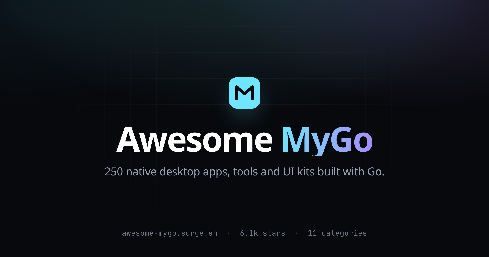

<div align="center">

<h1>Awesome MyGo</h1>

<p><strong>A curated list of desktop apps, tools and UI kits built with <a href="https://github.com/egoist/mygo">MyGo</a> — native Go UI, drawn on the GPU, no webview.</strong></p>

<p><a href="https://awesome.re"></a>


</p>

<p><strong><a href="https://awesome-mygo.surge.sh">Browse the searchable site →</a></strong></p>

<p><a href="https://awesome-mygo.surge.sh"></a></p>

</div>

---

MyGo draws its own widgets on the GPU — no HTML, no JavaScript, no webview — so an app ships as a single Go binary of a few megabytes that opens instantly and sips memory. It also runs web frontends in the platform webview when you want one, and can mix both in the same window.

This list collects what people have built with it: **372 projects**, from terminals and coding agents to music players, Git clients, database GUIs and component libraries. Every entry links to a public repository, and star counts were refreshed from the GitHub API when this page was generated.

## Contents

- [What is MyGo?](#what-is-mygo)
- [Start here](#start-here)
- [Apps by the Author](#apps-by-the-author)
- [AI, Agents & LLM Clients](#ai-agents--llm-clients)
- [Developer Tools](#developer-tools)
- [Editors, Notes & Writing](#editors-notes--writing)
- [Media, Players & Download](#media-players--download)
- [Productivity, Menu Bar & Launchers](#productivity-menu-bar--launchers)
- [System, Monitoring & Hardware](#system-monitoring--hardware)
- [Storage, Files & Sync](#storage-files--sync)
- [Network, Proxy & Remote](#network-proxy--remote)
- [Games & Fun](#games--fun)
- [UI Kits, Templates & Add-ons](#ui-kits-templates--add-ons)
- [More Projects Using MyGo](#more-projects-using-mygo)
- [Notes on inclusion](#notes-on-inclusion)
- [Contributing](#contributing)
- [License](#license)

## What is MyGo?

[MyGo](https://github.com/egoist/mygo) is a toolkit for writing desktop apps in Go. A window can show a native UI written in Go alone, or a web page in the webview the OS already has — and one app can mix the two.

- **Native UI** — flexbox and grid layout, widgets, text editing with input methods, virtualized lists, SVG icons, animations and screen-reader support, all drawn by MyGo.
- **Pure Go, no cgo** — cross-compile for macOS, Windows and Linux from any machine.
- **Desktop APIs** — windows, menus, tray, dialogs, notifications, global shortcuts, deep links, file associations and auto-updates.
- **Ready to ship** — app bundles, DMGs, Windows installers, Debian packages, Arch PKGBUILDs, signing and notarization.

A window with a native UI is a Go function of the app's state:

```go
type counter struct{ n int }

func (s *counter) view(c *ui.Context) {
	ui.Column(c).Fill().Center().Gap(12).Children(func() {
		ui.Text(c, fmt.Sprint(s.n)).FontSize(40).Bold()
		if ui.PrimaryButton(c, "Increment").Clicked() {
			s.n++
		}
	})
}

func main() {
	s := &counter{}
	mygo.App.WhenReady(func() {
		mygo.NewWindow(mygo.WindowOptions{
			Title:   "Counter",
			Content: ui.View(s.view),
		})
	})
	if err := mygo.App.Run(); err != nil {
		log.Fatal(err)
	}
}
```

```sh
go run github.com/egoist/mygo/cmd/mygo@latest init -template native my-app
```

Read the [MyGo documentation](https://github.com/egoist/mygo) to go further.

## Start here

Six projects that show what the toolkit feels like in practice:

- **[egoist/kero](https://github.com/egoist/kero)** — A terminal built for coding agents — sessions survive quitting, and agents can drive panes themselves. <sub>★ 1.4k</sub>
- **[egoist/mygo-cloudmusic](https://github.com/egoist/mygo-cloudmusic)** — A NetEase Cloud Music client with per-syllable lyrics and Hi-Res playback, drawn natively. <sub>★ 551</sub>
- **[hyoban/peek](https://github.com/hyoban/peek)** — A Git diff viewer where you can comment on lines and hand the comments to an agent as a prompt. <sub>★ 72</sub>
- **[oneo-me/onevra](https://github.com/oneo-me/onevra)** — A component library for MyGo native UI: themed controls, window shells, icons, charts and a command palette. <sub>★ 266</sub>
- **[sorrycc/Mayoi](https://github.com/sorrycc/Mayoi)** — A small, fast code editor with a GPU-drawn UI and no Electron in sight. <sub>★ 298</sub>
- **[Binaryify/MonitorBar](https://github.com/Binaryify/MonitorBar)** — Switch monitor inputs and volume from the macOS menu bar or the Windows tray. <sub>★ 176</sub>

## Apps by the Author

<sub>Open-source apps built by the creator of MyGo. · 6 projects</sub>

- **[egoist/kero](https://github.com/egoist/kero)** — A native terminal for coding agents: sessions run in the kerod daemon and survive quitting; the sidebar shows which one needs you and ⌘J jumps there; kero new / split / send / wait / read lets agents drive panes themselves; libghostty rendering with SSH / Tailscale / WSL remote hosts. <sub>★ 1.4k · MIT · [go.mod](https://raw.githubusercontent.com/egoist/kero/main/go.mod)</sub>
- **[egoist/mygo-cloudmusic](https://github.com/egoist/mygo-cloudmusic)** — A third-party NetEase Cloud Music client with native UI and no WebView: QR-code login, daily recommendations, private FM and heart-beat mode, per-syllable lyrics with a "rhythm" view; lossless and Hi-Res progressive playback, local caching, a notch mini-player, volume normalization and crossfade, light/dark themes. <sub>★ 551 · AGPL-3.0 · [go.mod](https://raw.githubusercontent.com/egoist/mygo-cloudmusic/main/go.mod)</sub>
- **[egoist/godraw](https://github.com/egoist/godraw)** — An infinite canvas drawing app by the author of MyGo. <sub>★ 233 · [go.mod](https://raw.githubusercontent.com/egoist/godraw/main/go.mod)</sub>
- **[egoist/gorex](https://github.com/egoist/gorex)** — Rex terminal clone in MyGo native UI. <sub>★ 215 · [go.mod](https://raw.githubusercontent.com/egoist/gorex/main/go.mod)</sub>
- **[egoist/godiff](https://github.com/egoist/godiff)** — A fast, native diff viewer. <sub>★ 135 · [go.mod](https://raw.githubusercontent.com/egoist/godiff/main/go.mod)</sub>
- **[egoist/2048](https://github.com/egoist/2048)** — 2048 game in MyGo native! <sub>unverified</sub>

## AI, Agents & LLM Clients

<sub>Coding agents, chat clients, voice input, token trackers and agent workbenches. · 67 projects</sub>

- **[nexmoe/DayBee](https://github.com/nexmoe/DayBee)** — A desktop microphone recorder with real-time on-device transcription, voice activity detection and an MCP server for searching saved transcripts. <sub>★ 428 · [go.mod](https://github.com/nexmoe/DayBee/blob/8ff28dc916ae73fb1fb746e938e13ee256f868eb/apps/desktop/go.mod)</sub>
- **[egoist/lorca](https://github.com/egoist/lorca)** — Imagine Telegram but single-user, with agents and end-to-end encryption — an alternative to Grok bot, Muse and Dots. <sub>★ 352 · GPL-3.0 · [go.mod](https://raw.githubusercontent.com/egoist/lorca/main/desktop/go.mod)</sub>
- **[Licoy/Quosparr](https://github.com/Licoy/Quosparr)** — A menu-bar/tray app tracking Codex, Claude Code and Grok quotas, resets, API-equivalent cost and local sessions, with multi-account and relay switching. <sub>★ 316 · AGPL-3.0</sub>
- **[hehehai/AudioSmith](https://github.com/hehehai/AudioSmith)** — Speech, voices, stories, audiobooks, dubbing and transcription, made on your Mac. Free and open source. <sub>★ 194 · AGPL-3.0 · [go.mod](https://raw.githubusercontent.com/hehehai/AudioSmith/main/go.mod)</sub>
- **[Bronya0/ally-agent](https://github.com/Bronya0/ally-agent)** — A desktop coding assistant for local projects that reads code, edits files, searches the workspace and manages tasks in conversation. <sub>★ 137 · GPL-3.0 · [go.mod](https://raw.githubusercontent.com/Bronya0/ally-agent/mygo/go.mod)</sub>
- **[AstraFoundry/Arion](https://github.com/AstraFoundry/Arion)** — Local-first voice dictation and Pinyin input method: hold-to-talk (right ⌥ on macOS, right Alt on Windows) to speak Mandarin, English or mixed technical terms in any focused editor, with recognition, full-Pinyin typing, correction learning and contextual polishing all on-device; Qwen3-ASR 1.7B runs locally (MLX on macOS, speech.cpp on Windows), with optional two-stage polishing that adapts wording to the visible app and cursor context; ships native system IME hosts (ArionInput.app / ArionTSF.dll), lives in the menu bar, keeps partial drafts in its floating pill until release, plus zero-knowledge sync and signed updates. <sub>★ 70 · AGPL-3.0</sub>
- **[ACAne0320/Tomoru](https://github.com/ACAne0320/Tomoru)** — Live bilingual subtitles for anything the computer plays — videos, streams, games and meetings — on-device or in the cloud. <sub>★ 27 · GPL-3.0 · [go.mod](https://github.com/ACAne0320/Tomoru/blob/190ac80636a0a45c894ef6665c28999adc7c66b9/app/go.mod)</sub>
- **[enowx/enowx](https://github.com/enowx/enowx)** — Run Claude Code, Codex and 43 other coding agents in parallel, each on its own branch in its own git worktree, on your machine or your own server. Watch, compare and merge them from one window. <sub>★ 27 · MIT · [go.mod](https://raw.githubusercontent.com/enowx/enowx/main/go.mod)</sub>
- **[digiogithub/pando](https://github.com/digiogithub/pando)** — A powerful AI coding agent. Built for the terminal. DIGIO Alchemai Project. <sub>★ 26 · MIT · [go.mod](https://raw.githubusercontent.com/digiogithub/pando/main/go.mod)</sub>
- **[lbr77/lody-mygo](https://github.com/lbr77/lody-mygo)** — A native desktop client for Lody, drawn on the GPU by MyGo's ui package with no web view: browser device-flow sign-in with Keychain-stored sessions; sessions grouped by machine and project with working/waiting/unread marks, pins, archive and forks; streaming Markdown with code highlighting, math and Mermaid; tool calls, thoughts, plans, diffs and subagents; @ mentions, $ skills and / shortcuts; scheduled tasks; plus a terminal, file explorer and Git worktrees from the local Lody daemon; a local-only mode and English/Simplified Chinese UI. <sub>★ 23 · AGPL-3.0</sub>
- **[aio-proxy/aio-proxy](https://github.com/aio-proxy/aio-proxy)** — A local AI gateway that serves OpenAI, Anthropic and Gemini clients from API keys or existing ChatGPT, Claude, Copilot and Cursor subscriptions, with protocol conversion, failover routing and request traces. <sub>★ 19 · MIT · [go.mod](https://github.com/aio-proxy/aio-proxy/blob/d1af533f0c24b5f713a0d6b7a551bdff1c36e894/desktop/go.mod)</sub>
- **[youfun/Handbean](https://github.com/youfun/Handbean)** — A local AI agent and experimental Linux desktop shell, with a MyGo desktop client. <sub>★ 18 · [go.mod](https://github.com/youfun/Handbean/blob/a6f7cb756d3bafabdc3d68e3ce1043a6727c5018/desktop/mygo/go.mod)</sub>
- **[kkkk2323/droi](https://github.com/kkkk2323/droi)** — Native Mac, Windows and iPhone app for Factory Droid: your droid Sessions in one window and on your phone, built with Go (MyGo) and Expo. <sub>★ 13 · MIT · [go.mod](https://raw.githubusercontent.com/kkkk2323/droi/main/apps/native/go.mod)</sub>
- **[getan/golder](https://github.com/getan/golder)** — A terminal coding agent with a split-pane workspace for the agent, shell and browser, sandboxed tools and 19 model gateways. <sub>★ 10 · MIT · [go.mod](https://raw.githubusercontent.com/getan/golder/master/go.mod)</sub>
- **[ChisaAlter/ChisaCloudCode](https://github.com/ChisaAlter/ChisaCloudCode)** — A Windows desktop client for a remote AI coding workspace on a VPS. <sub>★ 9 · AGPL-3.0 · [go.mod](https://github.com/ChisaAlter/ChisaCloudCode/blob/362d7f819932c17c1ecd2f9e2d404aca68f00c4e/app/go.mod)</sub>
- **[VaalaCat/openvaala](https://github.com/VaalaCat/openvaala)** — A self-hostable, general-purpose agent system: one runtime for the agent loop, tools on the machines you choose, and the same live conversations in every client. <sub>★ 8 · MIT · [go.mod](https://raw.githubusercontent.com/VaalaCat/openvaala/main/go.mod)</sub>
- **[nerv-base/mytoken](https://github.com/nerv-base/mytoken)** — Where did all your tokens go? Local token & cost tracker for AI coding harnesses — Claude Code, Codex, Gemini CLI, opencode, Cline and more. <sub>★ 7 · MIT</sub>
- **[zzstar101/mytoken](https://github.com/zzstar101/mytoken)** — Where did all your tokens go? Local token & cost tracker for AI coding harnesses — Claude Code, Codex, Gemini CLI, opencode, Cline and more. <sub>★ 7 · MIT · [go.mod](https://raw.githubusercontent.com/zzstar101/mytoken/main/go.mod)</sub>
- **[coderPerseus/popMind](https://github.com/coderPerseus/popMind)** — A selection-first desktop AI workspace that translates, explains and follows up on the text you are reading without switching apps. <sub>★ 5 · GPL-3.0 · [go.mod](https://raw.githubusercontent.com/coderPerseus/popMind/main/go.mod)</sub>
- **[kotuke/lumilo](https://github.com/kotuke/lumilo)** — A macOS menu bar panel for local LLM engines: runs Splash or llama.cpp, watches memory and speed, and fetches models from Hugging Face. <sub>★ 5 · MIT · [go.mod](https://github.com/kotuke/lumilo/blob/3e8288adc0813341f669296ad866156a1c22d793/go.mod)</sub>
- **[sorrycc/CCGuanjia](https://github.com/sorrycc/CCGuanjia)** — A Mac app that looks after Claude Code: profiles of your own accounts, install, usage and cleanup. <sub>★ 5 · MIT</sub>
- **[HycJack/mygo-agent](https://github.com/HycJack/mygo-agent)** — A Codex-style desktop AI coding agent built with MyGo — native GPU UI, built-in agent loop, skills and MCP. <sub>★ 3</sub>
- **[jerryfane/herdrup-desktop](https://github.com/jerryfane/herdrup-desktop)** — A Herdrup client for macOS, Linux and Windows, built with MyGo. <sub>★ 3 · Apache-2.0 · [go.mod](https://github.com/jerryfane/herdrup-desktop/blob/879ffc4564e10bd3988c9a2463757c57908ac7dc/go.mod)</sub>
- **[oysterhyd/minicode](https://github.com/oysterhyd/minicode)** — A shared agent harness with installable Windows desktop and CLI builds. <sub>★ 3 · MIT · [go.mod](https://github.com/oysterhyd/minicode/blob/89815baa526bd94fe3d8f7e153b3bde1dcd0c3d4/desktop/native/go.mod)</sub>
- **[Umupa/Kami](https://github.com/Umupa/Kami)** — A lightweight macOS AI assistant that translates, polishes and answers from a keyboard shortcut. <sub>★ 3 · Apache-2.0 · [go.mod](https://raw.githubusercontent.com/Umupa/Kami/main/go.mod)</sub>
- **[xxww0098/tulai](https://github.com/xxww0098/tulai)** — A cross-platform batch image-to-image desktop tool for Doubao and Qwen. <sub>★ 3 · MIT · [go.mod](https://github.com/xxww0098/tulai/blob/main/go.mod)</sub>
- **[baka-world/dsh-gtk](https://github.com/baka-world/dsh-gtk)** — DeepSeek Harness in a native GTK window: Go, MyGo and WebKitGTK, with no bundled Chromium. <sub>★ 2 · MIT · [go.mod](https://github.com/baka-world/dsh-gtk/blob/master/go.mod)</sub>
- **[horizon0514/ds-search](https://github.com/horizon0514/ds-search)** — A minimal macOS menu-bar search powered by the DeepSeek Search API, in MyGo native UI. <sub>★ 2 · MIT</sub>
- **[Maidang1/herdr-ui](https://github.com/Maidang1/herdr-ui)** — Native desktop client for Herdr: workspaces, worktrees, agent status and a built-in terminal with tabs, splits and prefix mode. <sub>★ 2 · MIT</sub>
- **[oysterhyd/AgentMeter](https://github.com/oysterhyd/AgentMeter)** — Windows desktop monitor for Codex quota, token usage, estimated costs and runtime metrics. <sub>★ 2</sub>
- **[xxww0098/xbs](https://github.com/xxww0098/xbs)** — A cross-platform batch image-to-image tool supporting Doubao and Qwen, in Go + MyGo. <sub>★ 2 · MIT</sub>
- **[yeshan333/tingsub](https://github.com/yeshan333/tingsub)** — Local bilingual live captions for English/Japanese browser audio; Apple Silicon + MLX, with a Chrome extension. <sub>★ 2 · MIT</sub>
- **[Beeta/voxi](https://github.com/Beeta/voxi)** — Meeting-recording transcription and summarization app on MyGo native UI. <sub>★ 1 · MIT</sub>
- **[bunnywaffle/llama-manager](https://github.com/bunnywaffle/llama-manager)** — Lightweight, high-performance desktop llama.cpp manager built with MyGo, featuring branching chat, multi-model router, and automated diagnostics. <sub>★ 1</sub>
- **[hehehai/Auralink](https://github.com/hehehai/Auralink)** — Voice input for macOS on remote models: speak in any app and the text lands at your cursor. Transcribe, translate and rewrite, with your own API keys. <sub>★ 1 · AGPL-3.0</sub>
- **[legibet/myskills](https://github.com/legibet/myskills)** — A CLI and desktop app for managing agent skills across agents and projects. <sub>★ 1 · MIT · [go.mod](https://raw.githubusercontent.com/legibet/myskills/main/go.mod)</sub>
- **[minifish-org/pith-desk](https://github.com/minifish-org/pith-desk)** — A thin local desktop agent powered by Pith, with workspace tools, MCP connections, and a TypeScript interface. <sub>★ 1 · AGPL-3.0</sub>
- **[Riablo/skills-hub](https://github.com/Riablo/skills-hub)** — A desktop app to manage agent skills in one place and install them globally or per project, locally or over SSH. Built with MyGo. <sub>★ 1</sub>
- **[tk103331/ChatGo](https://github.com/tk103331/ChatGo)** — A simple cross-platform AI chat client built with Go and MyGo, with multi-provider models, Agents, tools, MCP, ACP and a built-in terminal. <sub>★ 1 · MIT</sub>
- **[tviber/voice-morph](https://github.com/tviber/voice-morph)** — A MorphVOX Pro-style real-time voice changer: Go DSP engine + web frontend + MyGo desktop shell. <sub>★ 1</sub>
- **[xinde/deepseek-harness-mygo](https://github.com/xinde/deepseek-harness-mygo)** — Lightweight MyGO desktop launcher for a local DeepSeek Harness checkout. <sub>★ 1 · MIT</sub>
- **[YuanZhe-99/Kyokai](https://github.com/YuanZhe-99/Kyokai)** — A cross-platform Computer Use application that lets people and AI agents interact with the same desktop. <sub>★ 1 · AGPL-3.0</sub>
- **[ArnoChenFx/kura](https://github.com/ArnoChenFx/kura)** — Desktop skills manager built with MyGo. <sub>[go.mod](https://raw.githubusercontent.com/ArnoChenFx/kura/main/go.mod)</sub>
- **[cheese-zj/openconnector](https://github.com/cheese-zj/openconnector)** — One local connector hub for all your AI agents: connect Gmail, GitHub, Slack, Notion and Linear once, with many accounts, and share them with any agent over MCP or REST. <sub>MIT · [go.mod](https://raw.githubusercontent.com/cheese-zj/openconnector/main/go.mod)</sub>
- **[Clearzero22/pi-web-desktop](https://github.com/Clearzero22/pi-web-desktop)** — A MyGo shell for pi-web that runs the web UI against an isolated Node runtime.
- **[dhx007/mygo-dsh](https://github.com/dhx007/mygo-dsh)** — A recreation of the first-generation DeepSeek Harness desktop app in MyGo native UI: sessions, trajectory, four modes, tool approvals, PTC — pure Go, no WebView. <sub>MIT · unverified</sub>
- **[fondoger/mirrorbird](https://github.com/fondoger/mirrorbird)** — Continues the same ChatGPT Desktop or Codex session from your phone. <sub>[go.mod](https://github.com/fondoger/mirrorbird/blob/156693f84136f29b4235c0c92f8d53da0c4c4c29/go.mod)</sub>
- **[foyoodo/Cove](https://github.com/foyoodo/Cove)** — A native macOS chat client drawn with MyGo's ui package instead of a web view, talking to any OpenAI-compatible Chat Completions endpoint.
- **[gvenusleo/Atlas](https://github.com/gvenusleo/Atlas)** — A general-purpose agent built in Go. <sub>MIT</sub>
- **[Helix-lyh/leeway](https://github.com/Helix-lyh/leeway)** — A CLI probe for AI coding providers' usage, quota and reset times. <sub>MIT</sub>
- **[hifizz/morilo](https://github.com/hifizz/morilo)** — An early-stage desktop AI workspace with separate assistants, streaming replies, local profiles and optional app integrations. <sub>MIT · [go.mod](https://github.com/hifizz/morilo/blob/ba92b281e18de1279ecfd5069361642df374e8a0/go.mod)</sub>
- **[hoanglong2311/AI-limit](https://github.com/hoanglong2311/AI-limit)** — A macOS menu-bar app for viewing AI subscription usage.
- **[ijry/YoYoCode](https://github.com/ijry/YoYoCode)** — A native Go take on codeg: a collaborative multi-agent coding workspace that aggregates sessions from Claude Code, Codex, OpenCode, Pi, Grok Build and others. <sub>Apache-2.0 · unverified</sub>
- **[ixxxxoooo/ai-usage](https://github.com/ixxxxoooo/ai-usage)** — A macOS menu-bar AI billing helper: Cursor request usage and DeepSeek balance, credentials kept in Keychain. <sub>MIT</sub>
- **[javatoai/repodock](https://github.com/javatoai/repodock)** — Native Go and MyGo GitHub project launcher for Codex. <sub>MIT</sub>
- **[lexleizou/byop](https://github.com/lexleizou/byop)** — Native MyGo multi-plugin workbench for an external Pi CLI. <sub>MIT</sub>
- **[M2tHane/Distill](https://github.com/M2tHane/Distill)** — Distill local coding agent sessions (Claude Code, Codex, Pi) into skills, rules and AGENTS.md/CLAUDE.md.
- **[meimingqi222/devin-usage-metrics](https://github.com/meimingqi222/devin-usage-metrics)** — Local coding-agent analytics, now implemented in Go + MyGo native UI. No Rust compilation, WebView, JavaScript runtime, or cgo is required to build the desktop application.
- **[nggalek-co/titen](https://github.com/nggalek-co/titen)** — A native desktop meeting transcription app for macOS and Windows, built with MyGo native GPU widgets, Go and platform-specific capture helpers. It records system audio and microphone input and turns meetings into text.
- **[nguyenvanduocit/agentd](https://github.com/nguyenvanduocit/agentd)** — A daemon, tray app and Go hub library that runs coding agents locally for the apps you allow. <sub>MIT · [go.mod](https://github.com/nguyenvanduocit/agentd/blob/d14adbb2b952f49cf7bd013781110592c8423a3b/app/go.mod)</sub>
- **[onyx-dot-app/Capy](https://github.com/onyx-dot-app/Capy)** — Live captions and translation for audio and video on macOS. <sub>MIT · [go.mod](https://github.com/onyx-dot-app/Capy/blob/dc4737eb55c9bd009c7774cdff1e56b8de4bb0e5/go.mod)</sub>
- **[pararchy/para-term](https://github.com/pararchy/para-term)** — A personal terminal that runs Para CLI in a real pseudo-terminal inside a GPU-native window.
- **[skeleton1231/zcode-my-go](https://github.com/skeleton1231/zcode-my-go)** — Zgo — open-source desktop coding agent in pure Go (mygo native UI · ZCode-translated runtime · multi-provider). <sub>MIT</sub>
- **[songlairui/skills-reader](https://github.com/songlairui/skills-reader)** — A MyGo desktop reader for agent skills in ~/.agents/skills — grouped, nicely typeset, with lock-file based update checks.
- **[sunny0826/inferyard](https://github.com/sunny0826/inferyard)** — A benchmarking toolkit for local AI, with verifiable results. <sub>MIT · [go.mod](https://github.com/sunny0826/inferyard/blob/c74ef87c45980dac2df093748834df8683f193d7/studio/go.mod)</sub>
- **[zackzhou-work/spark-go](https://github.com/zackzhou-work/spark-go)** — A small macOS window that shows the live status of every session in the Code tab of Claude Desktop. Built with Go and the native UI of mygo. <sub>MIT</sub>
- **[zeokeel/ZeoKeel-Super-Agent](https://github.com/zeokeel/ZeoKeel-Super-Agent)** — A single-binary, cgo-free local AI assistant built with Go, eino and MyGo. <sub>MIT · [go.mod](https://github.com/zeokeel/ZeoKeel-Super-Agent/blob/main/go.mod)</sub>

## Developer Tools

<sub>Git clients, terminals, API clients, database GUIs, Kubernetes and infra tooling. · 55 projects</sub>

- **[bitxeno/atvloadly](https://github.com/bitxeno/atvloadly)** — A desktop tool that sideloads IPA files onto an Apple TV. <sub>★ 1.6k · AGPL-3.0 · [go.mod](https://github.com/bitxeno/atvloadly/blob/6806ba3110c600020534290b68c05042ba14e182/desktop/app/go.mod)</sub>
- **[hyoban/peek](https://github.com/hyoban/peek)** — A native Git diff viewer: a Changes mode stacking diffs with the history, and a Files mode reading any file as the commit has it. Changed files are grouped into code, tests, docs and generated files and marked viewed, with syntax-highlighted diffs in unified or side-by-side layout, step-through of every change, copyable line references and GitHub links, comments from the gutter that can be copied as an agent prompt, and Codex review findings shown under the lines they concern. Several repositories in one window, plus branch switching and PR checkout via the GitHub CLI. <sub>★ 72 · MIT · [go.mod](https://raw.githubusercontent.com/hyoban/peek/main/go.mod)</sub>
- **[Binaryify/MyGit](https://github.com/Binaryify/MyGit)** — Check your agent's changes, fast. A light, native git client for macOS, Windows and Linux, built with MyGo. <sub>★ 50 · MIT</sub>
- **[wibus-wee/see](https://github.com/wibus-wee/see)** — A desktop app for reading source code: tree, tabs, search, symbols, diffs and a terminal in one window. <sub>★ 18 · [go.mod](https://github.com/wibus-wee/see/blob/e0d5098c1eb3d05cf9a981ecb211b7de9f8409c0/go.mod)</sub>
- **[oneo-me/onegit](https://github.com/oneo-me/onegit)** — A worktree-centred macOS app for browsing many Git repositories in one window. <sub>★ 10 · MIT · [go.mod](https://github.com/oneo-me/onegit/blob/main/source_mygo/go.mod)</sub>
- **[RUBisco0211/unipac](https://github.com/RUBisco0211/unipac)** — An all-in-one package manager app for macOS. <sub>★ 7 · MIT · [go.mod](https://github.com/RUBisco0211/unipac/blob/792c5bca07987ac64e359e0d56109b0687c2833c/go.mod)</sub>
- **[welllog/otool](https://github.com/welllog/otool)** — A fast, lightweight pure-Go toolbox for development and daily operations, rendered natively on the GPU with no WebView and no cgo — about 15 MB of memory at rest. <sub>★ 6 · [go.mod](https://raw.githubusercontent.com/welllog/otool/main/go.mod)</sub>
- **[younland/apigo](https://github.com/younland/apigo)** — A Hoppscotch-shaped API debugger: no frontend toolchain, no WebView — the UI and logic are all Go, one file, fully offline. <sub>★ 6 · MIT</sub>
- **[pplmx/aurora](https://github.com/pplmx/aurora)** — A blockchain toolkit for VRF lotteries, signed voting, oracles and tokens, with a MyGo desktop front end beside the CLI and REST API. <sub>★ 5 · MIT · [go.mod](https://github.com/pplmx/aurora/blob/9e9ab0d3b062b204fa48493e63ab77d8a331c414/desktop/go.mod)</sub>
- **[cainiao524/hd2-font-maker-go](https://github.com/cainiao524/hd2-font-maker-go)** — A Windows tool that generates Helldivers 2 font-replacement mods from your own fonts, with 14 UI languages. <sub>★ 4 · MIT</sub>
- **[fachrihawari/omaterm](https://github.com/fachrihawari/omaterm)** — Oh My Terminal: a terminal workspace for running coding agents side by side. <sub>★ 4 · MIT</sub>
- **[CarlOpenLab/Gloss](https://github.com/CarlOpenLab/Gloss)** — Git client built for reviewing diffs: inline risk scan, topology graph, AI commit messages. Pure Go, GPU-rendered, zero WebView. macOS · Windows · Linux. <sub>★ 3 · MIT</sub>
- **[geeker-xiao/NanoAPI](https://github.com/geeker-xiao/NanoAPI)** — A lightweight native API client for Windows, macOS and Linux, with no WebView build chain. <sub>★ 3 · MIT · [go.mod](https://github.com/geeker-xiao/NanoAPI/blob/main/go.mod)</sub>
- **[javatoai/silverwing](https://github.com/javatoai/silverwing)** — A compact native multi-repo dev workbench in Go + MyGo (no WebView, no Electron), ~18 MB installer. <sub>★ 3 · MIT</sub>
- **[saanuregh/dgopher](https://github.com/saanuregh/dgopher)** — Fast, native database GUI: a SQL client for PostgreSQL, MySQL, ClickHouse, SQLite and DuckDB, and a Redis client. One Go binary, no Electron. Linux, macOS and Windows. <sub>★ 3 · Apache-2.0</sub>
- **[tacshi/Yeek](https://github.com/tacshi/Yeek)** — A native, cross-platform API client for HTTP, GraphQL, gRPC and WebSocket, written entirely in Go. <sub>★ 3 · MIT</sub>
- **[jhzhang09/gocompare](https://github.com/jhzhang09/gocompare)** — A native, cross-platform file and folder comparison tool written in Go — diff, three-way merge, safe folder sync, picture compare. GUI + CLI. <sub>★ 2 · MIT · [go.mod](https://raw.githubusercontent.com/jhzhang09/gocompare/main/go.mod)</sub>
- **[margbug01/Candle](https://github.com/margbug01/Candle)** — A TradingView-style Binance candlestick chart for Windows and macOS, with indicators, drawing tools and in-app updates. <sub>★ 2 · MIT · [go.mod](https://github.com/margbug01/Candle/blob/main/work/go.mod)</sub>
- **[syanbo/posse](https://github.com/syanbo/posse)** — A macOS terminal manager that runs several coding agents side by side and shows their state in one place. <sub>★ 2 · MIT · [go.mod](https://raw.githubusercontent.com/syanbo/posse/main/go.mod)</sub>
- **[blyrin/java-ide](https://github.com/blyrin/java-ide)** — A Java IDE with the MyGo native UI: project management, editor, build and run. <sub>★ 1 · unverified</sub>
- **[hunghg255/mycode](https://github.com/hunghg255/mycode)** — A small, fast code editor written in Go. It draws a native UI on the GPU with MyGo — no web view, no Electron. <sub>★ 1 · MIT</sub>
- **[laojianzi/aster](https://github.com/laojianzi/aster)** — A native Kubernetes workbench built with Go and MyGo Native UI. <sub>★ 1 · Apache-2.0</sub>
- **[OldPanda/bamboo](https://github.com/OldPanda/bamboo)** — A lightweight macOS app for exploring and querying Parquet files locally or in cloud storage. <sub>★ 1 · MIT · [go.mod](https://raw.githubusercontent.com/OldPanda/bamboo/main/go.mod)</sub>
- **[oshell-desktop/oshell-desktop](https://github.com/oshell-desktop/oshell-desktop)** — OShell Desktop — shared Go core and native desktop UI. <sub>★ 1 · GPL-3.0</sub>
- **[preceeder/gui-redis](https://github.com/preceeder/gui-redis)** — A desktop GUI for redis-cli on macOS and Windows. <sub>★ 1</sub>
- **[pteich/repo-hopper](https://github.com/pteich/repo-hopper)** — Quickly navigate and open your recently changed Git repos with a native app. <sub>★ 1 · MIT</sub>
- **[smallnest/nutty](https://github.com/smallnest/nutty)** — A native macOS terminal: a Go + MyGo recreation of otty.sh, built on the uix and onevra component libraries. <sub>★ 1 · Apache-2.0</sub>
- **[tiramission/oci-sync](https://github.com/tiramission/oci-sync)** — Sync local files or directories to OCI-compatible image registries. <sub>★ 1 · MIT · [go.mod](https://raw.githubusercontent.com/tiramission/oci-sync/main/go.mod)</sub>
- **[version-fox/vfox-plus](https://github.com/version-fox/vfox-plus)** — Experimental Web UI and cross-platform desktop application for the vfox CLI. <sub>★ 1 · Apache-2.0</sub>
- **[xleotranx/wada-terminal](https://github.com/xleotranx/wada-terminal)** — A native terminal for coding agents, built with Go, MyGo and wada-kit. <sub>★ 1 · MIT · [go.mod](https://raw.githubusercontent.com/xleotranx/wada-terminal/main/go.mod)</sub>
- **[yaffalhakim1/sweep](https://github.com/yaffalhakim1/sweep)** — Finds build output that is eating disk space and removes it in one pass, with no webview. <sub>★ 1 · MIT · [go.mod](https://github.com/yaffalhakim1/sweep/blob/0fb2ea7ac66735888cf8237c6dfd1d265b2d6f28/go.mod)</sub>
- **[a8b7/Rubick](https://github.com/a8b7/Rubick)** — Docker container management platform with Web UI.
- **[auron-labs/mygo-mcp](https://github.com/auron-labs/mygo-mcp)** — An opt-in Go library that lets an MCP client inspect, click, type into and screenshot MyGo views through headless fixtures. <sub>[go.mod](https://github.com/auron-labs/mygo-mcp/blob/main/go.mod)</sub>
- **[bernylinville/seismic](https://github.com/bernylinville/seismic)** — A native macOS Elasticsearch client — a ground-up native rewrite of elasticvue with feature parity (13 modules), pure Go, no cgo, no WebView.
- **[ca-x/nvflasher](https://github.com/ca-x/nvflasher)** — A MyGo desktop app for flashing and provisioning NVIDIA Jetson devices, with a Linux flashing backend. <sub>MIT</sub>
- **[CairnPack/Codei18nDesktop](https://github.com/CairnPack/Codei18nDesktop)** — Codei18n's graphical user interface window, based on mygo. <sub>MIT</sub>
- **[congthien2003/dbl](https://github.com/congthien2003/dbl)** — SBDb brings connection management, database exploration, table inspection and data editing into one focused desktop workspace. Built with Go and MyGo Native UI, it follows a simple, keyboard-friendly workflow.
- **[flowprog/png2ico](https://github.com/flowprog/png2ico)** — A PNG-to-ICO converter built with MyGo native, with GUI and command-line versions. The entire interface is written in Go. <sub>MIT</sub>
- **[ftech-vn/kubedesk](https://github.com/ftech-vn/kubedesk)** — A fast, light Kubernetes desktop client for people who juggle many clusters: live resources, logs, shells, a watchlist with notifications, a timeline of changes and production guardrails. <sub>MIT</sub>
- **[gantrol/YouRun](https://github.com/gantrol/YouRun)** — Manage local project commands from a desktop app or CLI. Built with Go, MyGo and React. <sub>Apache-2.0</sub>
- **[hoanglong2311/mcpgw](https://github.com/hoanglong2311/mcpgw)** — A local MCP gateway for macOS: declare each stdio MCP server once and a launchd daemon exposes it as a Streamable HTTP endpoint that every MCP client can share. <sub>[go.mod](https://raw.githubusercontent.com/hoanglong2311/mcpgw/main/go.mod)</sub>
- **[j4ckzh0u/BaudScan](https://github.com/j4ckzh0u/BaudScan)** — A read-only serial-port baud-rate detector with a native cross-platform MyGo interface. <sub>MIT · [go.mod](https://github.com/j4ckzh0u/BaudScan/blob/main/go.mod)</sub>
- **[jinghaihan/sift](https://github.com/jinghaihan/sift)** — Review complete feature branches without unrelated integration changes. <sub>MIT</sub>
- **[junga12/sso-glow](https://github.com/junga12/sso-glow)** — A macOS menu bar app that checks AWS SSO sessions and signs you back in. <sub>[go.mod](https://github.com/junga12/sso-glow/blob/main/go.mod)</sub>
- **[li-yifei/lom-dx2metal](https://github.com/li-yifei/lom-dx2metal)** — An offline Unity 2020.3 D3D11-to-Metal shader converter that lets the official macOS ARM64 player run Windows build data for Legend of Mortal. <sub>[go.mod](https://raw.githubusercontent.com/li-yifei/lom-dx2metal/main/go.mod)</sub>
- **[li-yifei/mygo-straddle-repro](https://github.com/li-yifei/mygo-straddle-repro)** — MyGo child-window bug minimal repro (multi-display).
- **[Moonvy/UPX-Installer-GO](https://github.com/Moonvy/UPX-Installer-GO)** — Adobe UPX/CEP Extension Installer, Windows/macOS app.
- **[nyakang/nyadb](https://github.com/nyakang/nyadb)** — NyaDB: a cross-platform native database workbench for organizing connections and working with SQL.
- **[Seevil/webtools](https://github.com/Seevil/webtools)** — SiteClone — a Windows desktop tool that downloads a site's static pages and assets, rewrites references to local paths and saves the result for offline viewing. <sub>[go.mod](https://raw.githubusercontent.com/Seevil/webtools/main/go.mod)</sub>
- **[shenjing023/KLineChart-go](https://github.com/shenjing023/KLineChart-go)** — KLineChart for Go — candlestick charts rendered in a MyGo native window. <sub>MIT · [go.mod](https://raw.githubusercontent.com/shenjing023/KLineChart-go/main/go.mod) · unverified</sub>
- **[xusenlin/berth](https://github.com/xusenlin/berth)** — A tool for deploying and managing server binaries from the desktop. <sub>[go.mod](https://github.com/xusenlin/berth/blob/a182b9131dd193bce42c4974acbbbad3bc2f9ee6/go.mod)</sub>
- **[zhengchalei/MQTT-Desktop](https://github.com/zhengchalei/MQTT-Desktop)** — A lightweight MQTT desktop client: multiple connections, MQTT 3.1.1/5.0, subscribe/publish and history.
- **[zhengchalei/port-kill](https://github.com/zhengchalei/port-kill)** — A visual Windows port manager that shows which process holds each TCP/UDP port and can end it. <sub>[go.mod](https://github.com/zhengchalei/port-kill/blob/4a50b74910a6bf0b3dbd8ef865af92191faea693/go.mod)</sub>
- **[ziludev/twill](https://github.com/ziludev/twill)** — A Git diff and staging client with a React view in the system webview and all Git work in Go through MyGo. <sub>[go.mod](https://github.com/ziludev/twill/blob/main/go.mod)</sub>
- **[zty012/guart](https://github.com/zty012/guart)** — A Go serial-port tool in MyGo native UI + MujicaUI; no WebView, no cgo.

## Editors, Notes & Writing

<sub>Code editors, Markdown notebooks, email clients and writing apps. · 21 projects</sub>

- **[sorrycc/Mayoi](https://github.com/sorrycc/Mayoi)** — A small, fast code editor written in Go, with a native GPU-drawn UI — no webview, no Electron. <sub>★ 298 · MIT · [go.mod](https://raw.githubusercontent.com/sorrycc/Mayoi/main/go.mod)</sub>
- **[mu-zi-lee/Tangentry](https://github.com/mu-zi-lee/Tangentry)** — Follow your curiosity — a local-first, multi-platform content aggregation, reading and notes app. <sub>★ 217 · MIT</sub>
- **[godwit-email/godwit](https://github.com/godwit-email/godwit)** — Open-source, hackable AI email client. <sub>★ 61 · Apache-2.0 · [go.mod](https://raw.githubusercontent.com/godwit-email/godwit/main/go.mod)</sub>
- **[echoVic/liubai](https://github.com/echoVic/liubai)** — A minimal Markdown writing app with multiple themes, paragraph focus and image-rich export. <sub>★ 13 · MIT · [go.mod](https://github.com/echoVic/liubai/blob/fa256567b8a6274be66dc1654b16b61686c1814c/go.mod)</sub>
- **[fzn0x/Nether](https://github.com/fzn0x/Nether)** — A self-hostable, local-first note-taking app that combines Notion and Obsidian features and imports vaults and Notion exports. <sub>★ 5 · AGPL-3.0 · [go.mod](https://github.com/fzn0x/Nether/blob/7eec694b1ab446f1c61e473cdcf62adf002d6ab5/apps/desktop/go.mod)</sub>
- **[oneo-me/locus](https://github.com/oneo-me/locus)** — A local-first Markdown notebook for macOS. Notes stay ordinary files you can edit anywhere, with HTML canvases, read-only MCP for Agents, and a built-in terminal. <sub>★ 5 · MIT</sub>
- **[lsj5031/joplin-lite](https://github.com/lsj5031/joplin-lite)** — A desktop client for Joplin notes. <sub>★ 4 · AGPL-3.0 · [go.mod](https://github.com/lsj5031/joplin-lite/blob/main/shell/go.mod)</sub>
- **[kiwiflydream/yunji-uml](https://github.com/kiwiflydream/yunji-uml)** — Native macOS editor for PlantUML, Mermaid, and Flowchart.js. <sub>★ 3 · MIT</sub>
- **[Oranjekop/TextViewer](https://github.com/Oranjekop/TextViewer)** — A Windows text viewer and editor. <sub>★ 3 · MIT · [go.mod](https://raw.githubusercontent.com/Oranjekop/TextViewer/main/go.mod)</sub>
- **[RSK21X/GoRss](https://github.com/RSK21X/GoRss)** — Native RSS and Atom reader for Apple Silicon Macs, built with MyGo and Onevra. <sub>★ 2</sub>
- **[sorrycc/Deckle](https://github.com/sorrycc/Deckle)** — A fast, native Markdown editor for macOS. <sub>★ 2 · MIT</sub>
- **[alvyn16/GOsidian](https://github.com/alvyn16/GOsidian)** — High-performance, local-first Obsidian clone built with MyGo (pure Go desktop runtime) and TypeScript. <sub>★ 1 · MIT</sub>
- **[logdns/imyemail-cloud](https://github.com/logdns/imyemail-cloud)** — Two open-source email editions: platform-native clients and Pulse-inspired Go/MyGo desktop. <sub>★ 1 · MIT</sub>
- **[LZD121/my-gotion](https://github.com/LZD121/my-gotion)** — A local-first Notion clone: block documents + database views, plain JSON files as the only data source, WebDAV / GitHub incremental sync. Go + mygo + React + TipTap. <sub>★ 1 · MIT</sub>
- **[CarlOpenLab/ccmail](https://github.com/CarlOpenLab/ccmail)** — A quiet multi-account IMAP/SMTP mail client with native MyGo controls, a single binary and encrypted credential storage. <sub>[go.mod](https://github.com/CarlOpenLab/ccmail/blob/main/go.mod)</sub>
- **[everpcpc/mica](https://github.com/everpcpc/mica)** — A focused, native Gmail client for macOS.
- **[kzheart/Dew](https://github.com/kzheart/Dew)** — A minimal desktop Markdown editor. <sub>MIT · [go.mod](https://github.com/kzheart/Dew/blob/2433012359e1f60594a9867e9e8c46f2639e5d59/go.mod)</sub>
- **[tbdsux/courrier](https://github.com/tbdsux/courrier)** — A simple desktop mail client. <sub>MIT · [go.mod](https://github.com/tbdsux/courrier/blob/faf592bbc80fc14716eb3991eab6b129550cc8c7/go.mod)</sub>
- **[xinde/Mote](https://github.com/xinde/Mote)** — A macOS menu-bar app for quick Markdown notes and quick focus timers.
- **[yangflow/oriel](https://github.com/yangflow/oriel)** — Personal mixed-timeline reader for RSS and RSSHub, in pure Go with native UI (MyGo). Desktop app and headless server in one program. <sub>MIT</sub>
- **[zucchiniEvader/kopi](https://github.com/zucchiniEvader/kopi)** — A minimal native code editor with Java language-server support, run/debug and Git change review. <sub>[go.mod](https://github.com/zucchiniEvader/kopi/blob/443d79fcb9d325a7c4a2973c9e81a734f0bcc3df/go.mod)</sub>

## Media, Players & Download

<sub>Music and video players, downloaders and media library front ends. · 44 projects</sub>

- **[elianiva/meiro](https://github.com/elianiva/meiro)** — A lightweight desktop player for YouTube Music with a native interface instead of a browser one — about 100 MB of memory, playing without loading the YouTube Music web page, with Last.fm scrobbling, synced lyrics and colors that match each song. <sub>★ 289 · GPL-3.0 · [go.mod](https://raw.githubusercontent.com/elianiva/meiro/master/go.mod)</sub>
- **[fzn0x/mixmusic](https://github.com/fzn0x/mixmusic)** — Spotify and YouTube Music in one player: one search, one queue, mixed playlists, synced lyrics and an equalizer with community themes, for macOS, Windows and Linux. <sub>★ 196 · GPL-3.0 · [go.mod](https://raw.githubusercontent.com/fzn0x/mixmusic/main/go.mod)</sub>
- **[vst93/bili-fm](https://github.com/vst93/bili-fm)** — Listen to Bilibili as audio — a player or study tool built natively in Go + mygo for Windows, macOS and Linux. <sub>★ 77 · Apache-2.0</sub>
- **[missuo/motrix-mygo](https://github.com/missuo/motrix-mygo)** — Motrix with a native Go UI on MyGo, driving the aria2 engine Motrix ships. No Electron, no webview. <sub>★ 55 · [go.mod](https://raw.githubusercontent.com/missuo/motrix-mygo/main/go.mod)</sub>
- **[kamiertop/videodown](https://github.com/kamiertop/videodown)** — A video downloader for Bilibili and Douyin. <sub>★ 52 · GPL-3.0 · [go.mod](https://github.com/kamiertop/videodown/blob/dee02d508205e8b01512433168745e093d63da1a/go.mod)</sub>
- **[LiorMoment/darkslide-gr](https://github.com/LiorMoment/darkslide-gr)** — A local editor that loads film looks and custom LUTs into a Ricoh GR III or GR IIIx. <sub>★ 52 · GPL-2.0 · [go.mod](https://github.com/LiorMoment/darkslide-gr/blob/4d7ad1a40da10572aba48177c946785de3087dc4/desktop/go.mod)</sub>
- **[margbug01/MySpotify](https://github.com/margbug01/MySpotify)** — An unofficial Spotify player for Windows that also plays full tracks on free accounts. <sub>★ 28 · AGPL-3.0 · [go.mod](https://github.com/margbug01/MySpotify/blob/8e5e97e0199c3b25b7acb2c51b8aa0e717118d05/go.mod)</sub>
- **[ca-x/lark](https://github.com/ca-x/lark)** — Lark — a beautiful web-based music player. <sub>★ 16 · AGPL-3.0 · [go.mod](https://raw.githubusercontent.com/ca-x/lark/main/desktop/go.mod)</sub>
- **[he-music/HE-Music](https://github.com/he-music/HE-Music)** — A music player with a native MyGo interface. <sub>★ 14 · AGPL-3.0 · [go.mod](https://github.com/he-music/HE-Music/blob/07f12a5a59f1704315f2b2b7a8c8474b5bbf793e/go.mod)</sub>
- **[yxxbc/haruhikage-app](https://github.com/yxxbc/haruhikage-app)** — A cross-platform music player with a native MyGo interface and no webview. <sub>★ 9 · AGPL-3.0 · [go.mod](https://github.com/yxxbc/haruhikage-app/blob/main/go.mod)</sub>
- **[AMDL-Web/apple-music-downloader](https://github.com/AMDL-Web/apple-music-downloader)** — An Apple Music downloader backend that resolves, downloads, decrypts, remuxes and tags lossless ALAC files, with live progress over SSE. <sub>★ 6 · AGPL-3.0 · [go.mod](https://github.com/AMDL-Web/apple-music-downloader/blob/653d8a1fd092cd72f938e52a1a0372b7bcb061ab/go.mod)</sub>
- **[fazi-gondal/video-downloader-mygo](https://github.com/fazi-gondal/video-downloader-mygo)** — Native desktop video downloader built with Go, MyGo, yt-dlp and FFmpeg. It analyzes videos and playlists, lets you choose quality, audio, subtitles and container, manages a download queue, converts local media and keeps a download history. <sub>★ 3 · MIT · [go.mod](https://raw.githubusercontent.com/fazi-gondal/video-downloader-mygo/main/go.mod)</sub>
- **[j4ckxyz/Aurelia](https://github.com/j4ckxyz/Aurelia)** — A fast, native music player for Jellyfin (macOS, Windows, Linux), built with MyGo. <sub>★ 3 · MIT</sub>
- **[Team-Quaver/quaver-astra](https://github.com/Team-Quaver/quaver-astra)** — A lightweight, cross-platform Quaver Music client with a native-like experience. built by MyGO. <sub>★ 3 · AGPL-3.0</sub>
- **[hackerlengyue/binggan](https://github.com/hackerlengyue/binggan)** — A local video toolkit: key extraction and management, course playback scheduling, batch decryption and asset management (MyGo + Vue). <sub>★ 2 · GPL-3.0</sub>
- **[ZypherChan/MusicComments](https://github.com/ZypherChan/MusicComments)** — Desktop app for random NetEase Cloud Music hot comments; Windows x64 and Linux x64 builds. <sub>★ 2</sub>
- **[biaobiaobiao108/fnmovie](https://github.com/biaobiaobiao108/fnmovie)** — Brings your fnOS movie library to the Windows desktop. <sub>★ 1</sub>
- **[freelxs/jstv-player](https://github.com/freelxs/jstv-player)** — A macOS player for the JSTV / CatPawOpen streaming protocol. <sub>★ 1 · MIT</sub>
- **[Itoktsnhc/WaveAlign](https://github.com/Itoktsnhc/WaveAlign)** — Aligns audio and video by waveform. <sub>★ 1 · MIT · [go.mod](https://github.com/Itoktsnhc/WaveAlign/blob/da5d802a183c201831cb3a888a474c27deee6774/go.mod)</sub>
- **[latiefahmad/ytbplus](https://github.com/latiefahmad/ytbplus)** — A native YouTube Music player with Last.fm scrobbling, synced lyrics and colours that follow each song. <sub>★ 1 · GPL-3.0 · [go.mod](https://github.com/latiefahmad/ytbplus/blob/dc8617628344317156ab521450329d0669173a74/go.mod)</sub>
- **[owocc/bowerbird](https://github.com/owocc/bowerbird)** — A cross-platform desktop digital asset manager built with MyGo (Go) in webview mode and React 19, TypeScript and Tailwind CSS v4 — the desktop shell migrated from Electron to MyGo. <sub>★ 1</sub>
- **[rzh0504/Qmdr](https://github.com/rzh0504/Qmdr)** — 🎵 QQmusic/Playlist Downloader. <sub>★ 1 · GPL-3.0</sub>
- **[ShellMonster/PudMusic](https://github.com/ShellMonster/PudMusic)** — A cross-platform desktop music player for Bilibili audio and local files, with a native MyGo UI. <sub>★ 1 · PolyForm-Noncommercial · [go.mod](https://raw.githubusercontent.com/ShellMonster/PudMusic/main/go.mod)</sub>
- **[steampixel007/Dipper](https://github.com/steampixel007/Dipper)** — A native anime-following desktop app built on MyGo Native UI + Go: Mikan catalog, RSS and a built-in BT downloader. <sub>★ 1</sub>
- **[xptea/curb](https://github.com/xptea/curb)** — A minimal native video and audio downloader. Paste a link, choose video or MP3 audio and a quality, then save the file locally. No WebView No Electron. <sub>★ 1 · MIT</sub>
- **[XueJie1/godrome](https://github.com/XueJie1/godrome)** — A lightweight native desktop music player for your own Navidrome / Subsonic library. <sub>★ 1 · MIT</sub>
- **[4202217/saundo](https://github.com/4202217/saundo)** — A pure-Go AirPlay 2 audio sender for Windows. <sub>GPL-3.0 · [go.mod](https://raw.githubusercontent.com/4202217/saundo/main/go.mod)</sub>
- **[Alpenl/wallpaper](https://github.com/Alpenl/wallpaper)** — Cross-platform live wallpaper MVP: native transcoding and per-app rules on macOS; Windows/Linux take a compatibility route.
- **[anamaxlec/live-mygo](https://github.com/anamaxlec/live-mygo)** — A native live-stream aggregator for macOS and Windows with multi-platform streams, real-time danmaku, follow management and multi-window viewing. <sub>AGPL-3.0 · [go.mod](https://github.com/anamaxlec/live-mygo/blob/d288ba660ae267a4350b71f216c4aa6e1953e9c2/go.mod)</sub>
- **[chemark/xingshu-music](https://github.com/chemark/xingshu-music)** — Xingshu Music — a personal NetEase Cloud Music client for macOS, built on mygo-cloudmusic. <sub>AGPL-3.0</sub>
- **[fazi-gondal/video](https://github.com/fazi-gondal/video)** — A feature-rich video player built with the MyGo. <sub>[go.mod](https://raw.githubusercontent.com/fazi-gondal/video/main/go.mod)</sub>
- **[hmgle/radio-desktop](https://github.com/hmgle/radio-desktop)** — Internet radio for macOS and Linux, built with Go, React and MyGo. <sub>GPL-3.0 · [go.mod](https://raw.githubusercontent.com/hmgle/radio-desktop/main/go.mod)</sub>
- **[hu-ja-ja/VocaBox_Desktop](https://github.com/hu-ja-ja/VocaBox_Desktop)** — A Windows player for Niconico music rankings. <sub>MPL-2.0 · [go.mod](https://raw.githubusercontent.com/hu-ja-ja/VocaBox_Desktop/main/go.mod)</sub>
- **[HycJack/mujicacut](https://github.com/HycJack/mujicacut)** — CapCut-style desktop video editor, GPU-drawn with MyGo + MujicaUI — no WebView, no HTML/JS. <sub>unverified</sub>
- **[josexy/go-downloader](https://github.com/josexy/go-downloader)** — A native desktop download manager built with Go and MyGo. <sub>MIT · [go.mod](https://github.com/josexy/go-downloader/blob/main/go.mod)</sub>
- **[jyuuroku16/mediago](https://github.com/jyuuroku16/mediago)** — A native, high-performance macOS media sniffer and downloader written in Go with MyGo's native UI.
- **[minittupoyo/aozora](https://github.com/minittupoyo/aozora)** — A Material 3 desktop client for Japanese TV catch-up streaming. <sub>[go.mod](https://github.com/minittupoyo/aozora/blob/b79e5be0f49a77d669fd2b15ea6161cc3b5153d4/go.mod)</sub>
- **[myoula/ape-player](https://github.com/myoula/ape-player)** — An Emby media player built for Omarchy.
- **[owocc/orbit360](https://github.com/owocc/orbit360)** — A 360-degree video player with gyroscope and drag control. <sub>[go.mod](https://github.com/owocc/orbit360/blob/ab2cebd9fd66ededc6e323ccd4a29b32ab5e1301/apps/gui/go.mod)</sub>
- **[Shirolin/videopress](https://github.com/Shirolin/videopress)** — A good-looking Windows video compressor, GUI + CLI. <sub>MIT</sub>
- **[Simqiqi/simqiqi-music](https://github.com/Simqiqi/simqiqi-music)** — A third-party NetEase Cloud Music desktop client with a native Go UI and no WebView: liquid glass, vinyl mode, per-syllable lyrics and smart transitions, built on mygo-cloudmusic. <sub>AGPL-3.0</sub>
- **[wobsoriano/glint](https://github.com/wobsoriano/glint)** — A Windows screenshot and screen recording app. <sub>MIT · [go.mod](https://github.com/wobsoriano/glint/blob/6319c4ca5d35f3798a814dfadcab136a2a13d305/go.mod)</sub>
- **[xlanstar/yt-music-player](https://github.com/xlanstar/yt-music-player)** — A lightweight native YouTube Music player for macOS, Linux and Windows that keeps playing in the background. <sub>MIT · [go.mod](https://github.com/xlanstar/yt-music-player/blob/cb3eee7bbcdfd9586ba68e78e9402ad8d837f011/go.mod)</sub>
- **[yaffalhakim1/playlist](https://github.com/yaffalhakim1/playlist)** — A native desktop player for YouTube playlists. MyGo, Onevra, Inter. No webview.

## Productivity, Menu Bar & Launchers

<sub>Launchers, timers, scratchpads and the small utilities that live in your menu bar. · 39 projects</sub>

- **[henryyu333/shelf](https://github.com/henryyu333/shelf)** — A native macOS app built entirely in Go with the MyGo framework. <sub>★ 103 · Apache-2.0</sub>
- **[egoist/uma](https://github.com/egoist/uma)** — A native menubar app for Umami.is. <sub>★ 44 · [go.mod](https://raw.githubusercontent.com/egoist/uma/main/go.mod)</sub>
- **[zkeq/vibe-cook](https://github.com/zkeq/vibe-cook)** — An immersive step-by-step cooking app built on HowToCook. <sub>★ 22 · BUSL-1.1 · [go.mod](https://github.com/zkeq/vibe-cook/blob/ea9427ba92a93e9ff0acd37af547cbe6b22d671a/native/desktop/go.mod)</sub>
- **[KirishimaRin/GDUT_Course_Helper](https://github.com/KirishimaRin/GDUT_Course_Helper)** — A course browser and registration helper for Guangdong University of Technology. <sub>★ 10 · [go.mod](https://github.com/KirishimaRin/GDUT_Course_Helper/blob/be0c75cd960a6f61070ca1d67437aa87444b120a/go.mod)</sub>
- **[eziq1/golauncher](https://github.com/eziq1/golauncher)** — A Raycast-style launcher for Windows and macOS, written in Go with the MyGo native UI toolkit. <sub>★ 6 · MIT</sub>
- **[echoVic/little-reef](https://github.com/echoVic/little-reef)** — Little Reef — grow a coral reef with your focus time, with a desktop widget, a visitor encyclopedia and offline background audio. <sub>★ 4 · MIT · [go.mod](https://github.com/echoVic/little-reef/blob/main/go.mod)</sub>
- **[iwangjie/xiangzhuan](https://github.com/iwangjie/xiangzhuan)** — A menu-bar break reminder: when time is up, a stick of incense burns fullscreen; when it burns out, back to work. <sub>★ 4 · MIT</sub>
- **[gomeen/Zakki](https://github.com/gomeen/Zakki)** — A macOS / Windows scratchpad: several colored tags each holding a snippet of Markdown. <sub>★ 2 · MIT</sub>
- **[ispacewang/quesora-native](https://github.com/ispacewang/quesora-native)** — A native Windows port of the Quesora quiz app, with offline question-bank import, daily practice and timed mock exams. <sub>★ 2 · Apache-2.0 · [go.mod](https://github.com/ispacewang/quesora-native/blob/8a7726d1fbf79c3db5d948afd378bb31f37c89fa/go.mod)</sub>
- **[LeuJasYoh/Type](https://github.com/LeuJasYoh/Type)** — A Windows input tool for pasting text into sites that block it. <sub>★ 2 · MIT · [go.mod](https://github.com/LeuJasYoh/Type/blob/e8ba14308455e747b6a986460bb9a1a010f434b4/go.mod)</sub>
- **[mintonight/pomodoro](https://github.com/mintonight/pomodoro)** — A minimal desktop Pomodoro timer: focus timing, overtime-cancel, stats heatmap, system tray and local SQLite storage. <sub>★ 2</sub>
- **[soidaken/ClipRecorder](https://github.com/soidaken/ClipRecorder)** — Native Windows screenshot / screen-record / selection-translate tool: local OCR + DeepSeek, no WebView. <sub>★ 2 · MIT</sub>
- **[tacshi/Unscan](https://github.com/tacshi/Unscan)** — Make scanned PDFs searchable, or retype them into clean text PDFs, entirely on your own machine. A macOS app and CLI in Go, without cgo, using PaddleOCR's PP-OCRv6. <sub>★ 2 · MIT</sub>
- **[ychuo/tavu](https://github.com/ychuo/tavu)** — Tavu is a native macOS workspace for running your tools, editing files, and reviewing changes in one place. Written in Go with MyGo. <sub>★ 2</sub>
- **[0froq/snip](https://github.com/0froq/snip)** — A minimal macOS clipboard manager prototype built with MyGo native UI. Each new plain-text copy spawns a small floating card, and global shortcuts show or hide the history. <sub>★ 1 · MIT</sub>
- **[alvin-7/motionduo](https://github.com/alvin-7/motionduo)** — Shares a single mouse and keyboard across computers on the local network. <sub>★ 1 · GPL-3.0 · [go.mod](https://github.com/alvin-7/motionduo/blob/735a452be7d6f190ae638721362845bb28c34b83/mousehop-mygo/go.mod)</sub>
- **[sorrycc/Shun](https://github.com/sorrycc/Shun)** — A macOS menu bar app that switches between apps with a global hotkey. <sub>★ 1 · [go.mod](https://github.com/sorrycc/Shun/blob/ef323f32e19bc83db6e31ab4c3c667931b6ba940/go.mod)</sub>
- **[zyition/voke](https://github.com/zyition/voke)** — Voke — a Windows launcher. <sub>★ 1 · MIT</sub>
- **[308K/my-doubtful-go](https://github.com/308K/my-doubtful-go)** — SmartAR Desktop: accounts-receivable aging analysis and bad-debt early warning (MyGo + React 19 + Shadcn UI + an Excelize dynamic formula engine). <sub>MPL-2.0</sub>
- **[azzliang6/pomodoro-mygo](https://github.com/azzliang6/pomodoro-mygo)** — A Pomodoro timer built with the pure-Go desktop framework MyGo. <sub>MIT</sub>
- **[cecil-su/mygo-browser](https://github.com/cecil-su/mygo-browser)** — Windows browser prototype with Go-native UI, MyGo and WebView2.
- **[chinnsenn/chrome-profile-router](https://github.com/chinnsenn/chrome-profile-router)** — A macOS default-browser router that sends links to the right Google Chrome profile. <sub>[go.mod](https://github.com/chinnsenn/chrome-profile-router/blob/main/go.mod)</sub>
- **[ctzcs/Timer](https://github.com/ctzcs/Timer)** — An always-on-top desktop timer widget styled after physical visual timers: a 30-segment bar plus a seven-segment LCD.
- **[dandibbert/textrouter](https://github.com/dandibbert/textrouter)** — TextSoap redesigned: one-click clipboard cleanup, readable find-and-replace, tabular batch replacement and visual action chains.
- **[dddaniel1/easy-dict-linux](https://github.com/dddaniel1/easy-dict-linux)** — A multi-source dictionary and translator for Linux with native MyGo views. <sub>GPL-3.0 · [go.mod](https://github.com/dddaniel1/easy-dict-linux/blob/226339430a2d46699f0b76cf3705527bc9b3e582/go.mod)</sub>
- **[feiniao233/MyCast](https://github.com/feiniao233/MyCast)** — Windows launcher built with Go/MyGo.
- **[HanlunWang/simple-toggle](https://github.com/HanlunWang/simple-toggle)** — Turn any script into a managed menu bar switch on macOS. <sub>MIT</sub>
- **[javatoai/sleepdock](https://github.com/javatoai/sleepdock)** — Native Go and MyGo sleep timer with tray controls. <sub>MIT</sub>
- **[Lonely0710/jpop-live-calendar](https://github.com/Lonely0710/jpop-live-calendar)** — A calendar of Japanese music live events and ticket dates. <sub>MIT · [go.mod](https://github.com/Lonely0710/jpop-live-calendar/blob/afae0601d9523fc76ea2a1d3f0472ce6eb820a2c/go.mod)</sub>
- **[m3hu1/mygo-todo](https://github.com/m3hu1/mygo-todo)** — Personal todo plus notes macos menubar app built using mygo.
- **[m3hu1/tuck](https://github.com/m3hu1/tuck)** — Personal todos and markdown notes in a tiny 3.8 MB package. Native macOS menu bar app: fast, light on resources, built with MyGo.
- **[nerv-base/MyToolbox](https://github.com/nerv-base/MyToolbox)** — A local, native, modular desktop toolbox that keeps daily chores light. <sub>AGPL-3.0</sub>
- **[QingYunA/withdo](https://github.com/QingYunA/withdo)** — A todo app for you and your coding agents: tasks and live agent status in one place. <sub>AGPL-3.0 · [go.mod](https://github.com/QingYunA/withdo/blob/f87c94172c8f4555ad6abeb92ee38d279f1c8a13/go.mod)</sub>
- **[Star-Trails/countdowner](https://github.com/Star-Trails/countdowner)** — A native Windows desktop countdown widget built with Go and MyGo.
- **[Uninen/floater](https://github.com/Uninen/floater)** — Opens URLs as simple chromeless windows. <sub>MIT · [go.mod](https://github.com/Uninen/floater/blob/bc9905ace9da30d9fd93e374c7e1c48f3ac99cbf/go.mod)</sub>
- **[uxuz/keyboardlock](https://github.com/uxuz/keyboardlock)** — A tiny macOS app that locks the keyboard with one click so it can be cleaned. <sub>MIT · [go.mod](https://github.com/uxuz/keyboardlock/blob/0befa1eb5f06a1d1e75fd4738ad1f7fc0eb1032f/go.mod)</sub>
- **[xiyaowong/quick-scan](https://github.com/xiyaowong/quick-scan)** — Scanner software for eSCL multifunction printers. <sub>MIT · [go.mod](https://github.com/xiyaowong/quick-scan/blob/65c79554220ceaca552b398959eac3be896f9459/go.mod)</sub>
- **[yinshuwei/mytools](https://github.com/yinshuwei/mytools)** — A developer toolbox built with mygo UI. <sub>MIT</sub>
- **[zephyr-qu/kanso](https://github.com/zephyr-qu/kanso)** — A small personal kanban board: Go backend + React frontend + SQLite, single-port.

## System, Monitoring & Hardware

<sub>System monitors, display and hardware control, desktop-shell experiments. · 22 projects</sub>

- **[Binaryify/MonitorBar](https://github.com/Binaryify/MonitorBar)** — Monitor management from the macOS menu bar / Windows tray: switches inputs and adjusts volume over the Xiaomi HyperOS LAN API, no DDC/CI needed. <sub>★ 176 · MIT · [go.mod](https://raw.githubusercontent.com/Binaryify/MonitorBar/main/go.mod)</sub>
- **[OUBIGFA/WinTray](https://github.com/OUBIGFA/WinTray)** — Starts any Windows program minimized to the tray or in the background. <sub>★ 93 · MIT · [go.mod](https://github.com/OUBIGFA/WinTray/blob/db9c545b4a7c0326c9f3978991ece72e3c55fe7d/go.mod)</sub>
- **[qzz0518/Charker](https://github.com/qzz0518/Charker)** — A native macOS companion for the Anker Prime 160W and 250W chargers. <sub>★ 62 · MIT · [go.mod](https://github.com/qzz0518/Charker/blob/ac691d45e95f2e3b58b529a3689648e7e18e0f71/charker-go/go.mod)</sub>
- **[voidksa/BootEase](https://github.com/voidksa/BootEase)** — A Windows BIOS, UEFI, recovery and system utility. <sub>★ 25 · GPL-3.0 · [go.mod](https://github.com/voidksa/BootEase/blob/c7eeede801ed26db7a944a662e9ef9020edd105a/native-app/go.mod)</sub>
- **[WonderLantern/z63-qemu](https://github.com/WonderLantern/z63-qemu)** — A desktop interface for a Nikon Z6III camera emulator. <sub>★ 18 · [go.mod](https://github.com/WonderLantern/z63-qemu/blob/4fb80a50c2d2a32680c88f7aa85e2921ad75e026/z63ui/go.mod)</sub>
- **[xbenduan/vitals](https://github.com/xbenduan/vitals)** — A tiny macOS app that does exactly one thing well. <sub>★ 12</sub>
- **[oneo-me/neohm](https://github.com/oneo-me/neohm)** — A macOS menu-bar app for controlling Home Assistant devices, with full air-conditioner controls. Built in Go with MyGo and Onevra. <sub>★ 9 · [go.mod](https://raw.githubusercontent.com/oneo-me/neohm/main/source/go.mod)</sub>
- **[Bush2021/pitstop](https://github.com/Bush2021/pitstop)** — Sets up, updates and configures portable Chrome on Windows. <sub>★ 7 · GPL-3.0 · [go.mod](https://github.com/Bush2021/pitstop/blob/8e24af83c415b66c4b6cca52a305fa167c2cfd05/go.mod)</sub>
- **[e1roy/stage-manager-for-windows](https://github.com/e1roy/stage-manager-for-windows)** — macOS-style Stage Manager for Windows 10/11: keep the current app on stage and group the rest into a sidebar, one per monitor. Pure Go, no cgo, no WebView. <sub>★ 7 · MIT</sub>
- **[qzz0518/Moniflip](https://github.com/qzz0518/Moniflip)** — Flip a monitor to another computer over DDC/CI, from the macOS status bar / Windows tray. <sub>★ 2 · MIT</sub>
- **[faintghost/mac2mqtt](https://github.com/faintghost/mac2mqtt)** — A native macOS menu bar app that reports Now Playing, media controls and system state to Home Assistant over MQTT. <sub>★ 1 · MIT · [go.mod](https://github.com/faintghost/mac2mqtt/blob/main/go.mod)</sub>
- **[rayorole/orole-os-desktop](https://github.com/rayorole/orole-os-desktop)** — Orole OS — a personal operating environment for Windows, built with MyGo, a Go daemon and React. <sub>★ 1 · MIT</sub>
- **[real-jacket/orbit](https://github.com/real-jacket/orbit)** — A native macOS client for the Mole cleanup CLI. <sub>★ 1 · GPL-3.0 · [go.mod](https://github.com/real-jacket/orbit/blob/ab9d8a0ed3ea7d910f55d8ba0d0ccda35c221f9a/go.mod)</sub>
- **[17130239-coder/Pulse](https://github.com/17130239-coder/Pulse)** — ⚡ Pulse — Native macOS System & Hardware Activity Monitor in Pure Go (via MyGo framework with GPU Metal rendering).
- **[fondoger/mouse-mapper](https://github.com/fondoger/mouse-mapper)** — A quiet mouse side-button remapper for Windows and macOS, built entirely with MyGo Native UI. <sub>MIT</sub>
- **[jitunayak/android-desk](https://github.com/jitunayak/android-desk)** — A desktop mode for Android phones on a Mac: a control bar over a scrcpy virtual display, with an app drawer. <sub>GPL-3.0 · [go.mod](https://github.com/jitunayak/android-desk/blob/a6f4dcc1cab7de5c8fd7b4e0a6700d64ffd159e0/desk-gui/go.mod)</sub>
- **[lesenelir/stock-float-mygo-native](https://github.com/lesenelir/stock-float-mygo-native)** — A tiny always-on-top macOS panel for live stock prices, in pure Go with MyGo native UI (no webview). <sub>MIT</sub>
- **[qzh200/Viper](https://github.com/qzh200/Viper)** — A native hardware control centre and CLI for Acer Predator and Nitro laptops. <sub>MIT · [go.mod](https://github.com/qzh200/Viper/blob/fe9c22ce71c4c3c36a3eda83d81a5a972917d45b/go.mod)</sub>
- **[sugarbearr/gogo-explorer](https://github.com/sugarbearr/gogo-explorer)** — A from-scratch, opinionated take on the Windows Task Manager. There is no sidebar and no tab bar: the process table is the main screen, and selecting a row opens a detail panel for that process. <sub>MIT</sub>
- **[VeinsureLee/BYR-Client](https://github.com/VeinsureLee/BYR-Client)** — A local desktop client for the BYR BBS forum; Go logic + MyGo native UI, Windows first.
- **[villatothesea/DumpingGround](https://github.com/villatothesea/DumpingGround)** — Windows-native maintenance utility — process viewer, disk-usage analyzer, safe cleanup with recycle-bin and backup guarantees. <sub>MIT</sub>
- **[wan-kong/apex-helper](https://github.com/wan-kong/apex-helper)** — Disables the keys that ruin your aim — yes Apex, that's you.

## Storage, Files & Sync

<sub>Object storage, backup, clipboard, file managers and disk tools. · 32 projects</sub>

- **[OUBIGFA/WinTab](https://github.com/OUBIGFA/WinTab)** — A Windows 11 tool that opens every folder in the same window, with double-click-to-close on the title bar. <sub>★ 113 · MIT · [go.mod](https://github.com/OUBIGFA/WinTab/blob/4cde3eb837d239fd6de6ab17be2be6f14f798929/WinTab.Desktop/go.mod)</sub>
- **[DejavuMoe/Pail](https://github.com/DejavuMoe/Pail)** — Cross-platform desktop manager for S3-compatible object storage: Amazon S3, MinIO, Cloudflare R2, VersityGW, Wasabi and other services that speak the S3 API. <sub>★ 54 · MIT</sub>
- **[pteich/us3ui](https://github.com/pteich/us3ui)** — 🗂️ Universal Cross-Platform native s3 Object Storage GUI and FileManager. <sub>★ 36 · MIT · [go.mod](https://raw.githubusercontent.com/pteich/us3ui/main/go.mod)</sub>
- **[vfasky/mygo-vaultwarden](https://github.com/vfasky/mygo-vaultwarden)** — Your Vaultwarden, native on your Mac. <sub>★ 17</sub>
- **[Nigh/ReSoBackup](https://github.com/Nigh/ReSoBackup)** — Reed-Solomon erasure-coding backup with AES-256 encryption, in both GUI and CLI. <sub>★ 15 · LGPL-2.1</sub>
- **[echoVic/cleanzo](https://github.com/echoVic/cleanzo)** — A safety-first macOS cleaner: junk rules, space analysis, large files, similar photos and app uninstalling. <sub>★ 12 · MIT</sub>
- **[younland/RcloneDrive](https://github.com/younland/RcloneDrive)** — Mounts 70+ rclone storage backends as local drives in MyGo native UI: single binary, no WebView, tray, auto-update — an open-source RaiDrive alternative. <sub>★ 9 · MIT</sub>
- **[DiiKhanh/burrow](https://github.com/DiiKhanh/burrow)** — Burrow is a free, open-source macOS app (Apple Silicon) that frees disk space and shows the live health of your Mac. <sub>★ 2 · GPL-3.0</sub>
- **[echoVic/clipnest](https://github.com/echoVic/clipnest)** — A lightweight macOS clipboard history panel with shortcuts, scroll selection and content previews. <sub>★ 2 · MIT · [go.mod](https://raw.githubusercontent.com/echoVic/clipnest/main/go.mod)</sub>
- **[aouyitanaka/Fsearch-Mygo-GUI](https://github.com/aouyitanaka/Fsearch-Mygo-GUI)** — A native desktop front end for fsearch, the fast file-search utility. <sub>★ 1</sub>
- **[Eurekaimer/TOUKO](https://github.com/Eurekaimer/TOUKO)** — TOUKO treats image management as tree-oriented repository operations instead of individual file uploads. <sub>★ 1 · MIT</sub>
- **[lfcypo/pickphoto](https://github.com/lfcypo/pickphoto)** — Quick photo sorting and organizing. <sub>★ 1 · MIT</sub>
- **[Magnetkopf/aim](https://github.com/Magnetkopf/aim)** — Love ur AppImage. <sub>★ 1 · GPL-3.0</sub>
- **[michaelmjhhhh/Chaos](https://github.com/michaelmjhhhh/Chaos)** — A macOS utility for handling screenshots. <sub>★ 1 · MIT</sub>
- **[msongd/kimquy](https://github.com/msongd/kimquy)** — Local semantic search across text, documents, images, audio and video on macOS, fully offline. <sub>★ 1 · MIT · [go.mod](https://github.com/msongd/kimquy/blob/3ef761e932c5575f0657235331128dc79bbb00f7/ui/go.mod)</sub>
- **[reixie/keeps](https://github.com/reixie/keeps)** — Keeps is a native macOS library for images, videos, GIFs, and web links. Collect inspiration, organize collections, and keep your library on your Mac. <sub>★ 1 · MIT · [go.mod](https://raw.githubusercontent.com/reixie/keeps/main/go.mod)</sub>
- **[1e4DouWine/clipboard_go](https://github.com/1e4DouWine/clipboard_go)** — A simple clipboard tool written in Go with MyGo native UI. <sub>unverified</sub>
- **[andrewtdiz/Disklens](https://github.com/andrewtdiz/Disklens)** — A native Windows and macOS disk usage explorer with treemaps and directory snapshot diffs. <sub>[go.mod](https://github.com/andrewtdiz/Disklens/blob/main/go.mod)</sub>
- **[hamidriaz1998/lookback](https://github.com/hamidriaz1998/lookback)** — Native semantic search for images and documents, running MyGo with EmbeddingGemma and Turso. <sub>MIT · [go.mod](https://github.com/hamidriaz1998/lookback/blob/main/go.mod)</sub>
- **[huynhkinhao1910/scan-image](https://github.com/huynhkinhao1910/scan-image)** — Finder and Spotlight are slow on SMB network drives because every search asks the server again. Scan Image walks the tree once, keeps the index in RAM and on disk, then only rescans what changed.
- **[HycJack/mygo-tendedero](https://github.com/HycJack/mygo-tendedero)** — Tendedero screenshot-line app, ported from SwiftUI/AppKit to MyGo (Go).
- **[L92-Labs/myclip](https://github.com/L92-Labs/myclip)** — Local-only clipboard history for macOS and Linux. Open source, built with Go/MyGo. No cloud, accounts or telemetry. <sub>MIT · [go.mod](https://raw.githubusercontent.com/L92-Labs/myclip/main/go.mod)</sub>
- **[logdns/newtofile](https://github.com/logdns/newtofile)** — Native macOS Finder file creation utility built with Go/MyGo and Swift. <sub>MIT</sub>
- **[mcxen/WinExplorer](https://github.com/mcxen/WinExplorer)** — A pure-native file manager visually aligned with the Windows 11 Explorer; icons and thumbnails drawn on the GPU by Go.
- **[Prit36/quarry-disk-analyzer](https://github.com/Prit36/quarry-disk-analyzer)** — Quarry: a fast, native Windows disk space analyzer in Go. Direct NTFS MFT reading, Explorer-style tree, powerful search, synchronized treemap. <sub>MIT</sub>
- **[sogud/catview](https://github.com/sogud/catview)** — A lightweight, local-first native macOS file reader. <sub>MIT · [go.mod](https://github.com/sogud/catview/blob/d1c16cfa4eed02d6d4dea2e62471d1c3099689fb/go.mod)</sub>
- **[tbdsux/keydepot](https://github.com/tbdsux/keydepot)** — A desktop vault that keeps SSH, PGP and other private keys encrypted with AES-256-GCM on your own machine, grouped by project and one copy away. <sub>MIT · [go.mod](https://raw.githubusercontent.com/tbdsux/keydepot/main/go.mod)</sub>
- **[thedavidweng/rainforest](https://github.com/thedavidweng/rainforest)** — Rainforest — Unofficial cross-platform desktop backup and transfer client for Amazon Photos. <sub>AGPL-3.0</sub>
- **[viewhang/go_paste](https://github.com/viewhang/go_paste)** — A clipboard manager for macOS and Windows, built with Go and MyGo. <sub>MIT · [go.mod](https://raw.githubusercontent.com/viewhang/go_paste/main/go.mod)</sub>
- **[zachzhao1984/bucketeer](https://github.com/zachzhao1984/bucketeer)** — A native macOS client for Cloudflare R2 and S3-compatible storage, built with Go and MyGo.
- **[zachzhao1984/twintrail](https://github.com/zachzhao1984/twintrail)** — A native dual-pane macOS file manager built with Go and myGO.
- **[ZeroDevi1/nomo-mygo](https://github.com/ZeroDevi1/nomo-mygo)** — Nomo rewritten on MyGo (Go desktop shell). <sub>AGPL-3.0</sub>

## Network, Proxy & Remote

<sub>Proxy clients, VPNs, campus-network helpers and remote access. · 36 projects</sub>

- **[AstraFoundry/KumoApp](https://github.com/AstraFoundry/KumoApp)** — A calm, native macOS client for the Mihomo proxy core, built with SwiftUI and a shared agent-friendly CLI. <sub>★ 294 · AGPL-3.0</sub>
- **[Licoy/sshyard](https://github.com/Licoy/sshyard)** — A native desktop SSH and SFTP client for macOS, Windows and Linux, with terminals, file management and an AI assistant. <sub>★ 90 · AGPL-3.0 · [go.mod](https://github.com/Licoy/sshyard/blob/c3d336262f398ff3b2dede61847692a24267e15a/go.mod)</sub>
- **[lufficc/clash-traffic](https://github.com/lufficc/clash-traffic)** — See where your Clash Verge traffic goes — by app, site, proxy node, subscription and device. <sub>★ 68</sub>
- **[marukolibro/Hop](https://github.com/marukolibro/Hop)** — A native macOS and Windows proxy client for mihomo (Clash.Meta). Built in Go with MyGo, no webview. <sub>★ 18 · GPL-3.0 · [go.mod](https://raw.githubusercontent.com/marukolibro/Hop/main/go.mod)</sub>
- **[Licoy/CPA-Bar](https://github.com/Licoy/CPA-Bar)** — Keep an eye on your CLIProxyAPI servers from the menu bar. <sub>★ 15 · AGPL-3.0</sub>
- **[hygkui/v5vpn-rea-client](https://github.com/hygkui/v5vpn-rea-client)** — Unofficial Go + MyGo desktop client for LeadSec V5VPN SSL VPN portals (protocol v2.0). <sub>★ 13 · Apache-2.0</sub>
- **[xiaomai1011/GZIST-NetKeeper](https://github.com/xiaomai1011/GZIST-NetKeeper)** — Campus-network auto-login keeper for GZIST: adapts to the new Dr.COM/eportal portal, auto-reconnects, autostarts, runs in background. <sub>★ 9</sub>
- **[jfut/ssh-keyselect](https://github.com/jfut/ssh-keyselect)** — An interactive SSH agent proxy that lets you choose which keys an SSH client may offer. <sub>★ 8 · Apache-2.0 · [go.mod](https://github.com/jfut/ssh-keyselect/blob/55e3a3de5d80bd149c803aa9b3332bcf63714070/go.mod)</sub>
- **[RedwindA/gotify-desktop](https://github.com/RedwindA/gotify-desktop)** — A receive-only desktop client for Gotify. Works on macOS, Windows and Linux. <sub>★ 8 · GPL-3.0</sub>
- **[xiaomai1011/GZIST-DormSignin-Baiyun](https://github.com/xiaomai1011/GZIST-DormSignin-Baiyun)** — Dorm sign-in client for GZIST Baiyun campus; Go + MyGo, Windows x64. <sub>★ 7</sub>
- **[si-mods/MyVNC](https://github.com/si-mods/MyVNC)** — A pure-Go VNC viewer for Windows built with MyGo, ported from TigerVNC. <sub>★ 6 · GPL-2.0</sub>
- **[margbug01/ShoesGUI](https://github.com/margbug01/ShoesGUI)** — A native GUI for the shoes proxy core on Windows and macOS. <sub>★ 5 · GPL-3.0 · [go.mod](https://github.com/margbug01/ShoesGUI/blob/main/work/go.mod)</sub>
- **[moxuun/sing-box-drover-go](https://github.com/moxuun/sing-box-drover-go)** — A tray controller for sing-box — the Go rewrite of sing-box-dover, supporting ref1nd-style providers. <sub>★ 5 · MIT</sub>
- **[xiaomai1011/GZIST-Hotspot](https://github.com/xiaomai1011/GZIST-Hotspot)** — Turns campus wired network into a hotspot: one-click toggle, auto anti-disconnect, NIC adaptation. <sub>★ 4 · MIT</sub>
- **[Sakurasan/ClashX-Go](https://github.com/Sakurasan/ClashX-Go)** — A macOS menu bar proxy client modeled closely on ClashX. <sub>★ 3 · AGPL-3.0</sub>
- **[zdyxry/TierGo](https://github.com/zdyxry/TierGo)** — An unofficial EasyTier desktop client built with MyGo. <sub>★ 3 · MIT · [go.mod](https://github.com/zdyxry/TierGo/blob/1a5d9319e8c028405a34bda7cdb2dd016a9ea33d/go.mod)</sub>
- **[Binaryify/proxy-bridge](https://github.com/Binaryify/proxy-bridge)** — A macOS menu-bar tool that routes all or per-app traffic into HTTP/HTTPS/SOCKS5 proxies over TUN. <sub>★ 1 · GPL-3.0</sub>
- **[Jonkimi/mygo-naive-client](https://github.com/Jonkimi/mygo-naive-client)** — A cross-platform NaiveProxy client with a pure-Go GPU-rendered native UI. <sub>★ 1 · AGPL-3.0 · [go.mod](https://github.com/Jonkimi/mygo-naive-client/blob/main/go.mod)</sub>
- **[Kel077/pith](https://github.com/Kel077/pith)** — Chooses the network interface each app on an Apple silicon Mac goes out through, with per-app, per-domain and per-IP routing. <sub>★ 1 · MIT · [go.mod](https://github.com/Kel077/pith/blob/main/go.mod)</sub>
- **[lesnolie/bunnybox](https://github.com/lesnolie/bunnybox)** — An unofficial Windows GUI for sing-box. <sub>★ 1 · GPL-3.0 · [go.mod](https://raw.githubusercontent.com/lesnolie/bunnybox/main/go.mod)</sub>
- **[Qsnh/lanscout](https://github.com/Qsnh/lanscout)** — See which devices are on your LAN, which IP each one holds and which addresses are still free. <sub>★ 1 · GPL-3.0 · [go.mod](https://raw.githubusercontent.com/Qsnh/lanscout/main/go.mod)</sub>
- **[111inhistory/lsw-rdp-launcher-go](https://github.com/111inhistory/lsw-rdp-launcher-go)** — Starts a Windows virtual machine and its RDP session from Linux in one step. <sub>MIT · [go.mod](https://github.com/111inhistory/lsw-rdp-launcher-go/blob/35375937e2673c29434aa92bc4b5e7d53ec54232/go.mod)</sub>
- **[alanbulan/meridian-vpn](https://github.com/alanbulan/meridian-vpn)** — A lightweight native desktop VPN client built with Go and MyGo. <sub>[go.mod](https://github.com/alanbulan/meridian-vpn/blob/main/go.mod)</sub>
- **[bitoolkit/biternet-go](https://github.com/bitoolkit/biternet-go)** — A Beijing Institute of Technology campus-network client written in Go and MyGo. <sub>Unlicense · [go.mod](https://raw.githubusercontent.com/bitoolkit/biternet-go/main/go.mod)</sub>
- **[charlzyx/clash-go](https://github.com/charlzyx/clash-go)** — A Clash Verge Rev clone in Go with a native MyGo UI on top of mihomo. <sub>MIT · [go.mod](https://github.com/charlzyx/clash-go/blob/main/go.mod)</sub>
- **[Fan-chou/magpie-native-routing](https://github.com/Fan-chou/magpie-native-routing)** — A standalone native client for observing Magpie's real routing behavior.
- **[firdausmntp/Jalin](https://github.com/firdausmntp/Jalin)** — A Windows network speed tester and real-time traffic monitor with a floating taskbar meter, in pure Go without cgo. <sub>[go.mod](https://github.com/firdausmntp/Jalin/blob/21ca02692019f4c1b27050f54197e4f348a9cded/go.mod)</sub>
- **[jiqing112/frpcclient](https://github.com/jiqing112/frpcclient)** — A graphical frp client manager for Windows 10/11: edit frpc TOML visually and start/stop the process.
- **[jnnbimo/RayDock](https://github.com/jnnbimo/RayDock)** — A Windows Xray client in Go + MyGo: native glass UI, TUN, proxy chains and dedicated ports. <sub>MIT</sub>
- **[liangzhiyu/portglass](https://github.com/liangzhiyu/portglass)** — A native macOS port traffic inspector with HTTP/TCP capture and a liquid-glass interface. <sub>MIT · [go.mod](https://github.com/liangzhiyu/portglass/blob/main/go.mod)</sub>
- **[logdns/Win-XinAi-De-Tools](https://github.com/logdns/Win-XinAi-De-Tools)** — A native Windows network toolbox: firewall, network config, SMB, WSL and a temporary HTTP server; bilingual, light/dark themes. <sub>MIT</sub>
- **[qmaru/wgm](https://github.com/qmaru/wgm)** — A native WireGuard manager built with Go and MyGo's native UI. <sub>[go.mod](https://raw.githubusercontent.com/qmaru/wgm/main/go.mod)</sub>
- **[renyijiu/lan-share](https://github.com/renyijiu/lan-share)** — A cross-platform read-only SMB desktop server built with Go and MyGo. <sub>MIT · [go.mod](https://github.com/renyijiu/lan-share/blob/74207b89e01a89877a0905435607d2552bdd6746/go.mod)</sub>
- **[sbgayhub/vRay](https://github.com/sbgayhub/vRay)** — A native desktop proxy client built on xray with a MyGo interface. <sub>[go.mod](https://github.com/sbgayhub/vRay/blob/master/go.mod)</sub>
- **[tacshi/ProxyGo](https://github.com/tacshi/ProxyGo)** — A native macOS debugging proxy for HTTP, HTTPS and WebSocket traffic. <sub>[go.mod](https://github.com/tacshi/ProxyGo/blob/3d5d0aa351e13de2bca4ce1dc2d5ae339cdee826/go.mod)</sub>
- **[xiyaowong/lslan](https://github.com/xiyaowong/lslan)** — A Windows LAN scanner that finds devices and open ports, with ping, traceroute and wake-on-LAN. <sub>MIT · [go.mod](https://github.com/xiyaowong/lslan/blob/03933648087a320d7224bdca07f48d3adc43144a/go.mod)</sub>

## Games & Fun

<sub>Games, game tooling, calculators and playful experiments. · 17 projects</sub>

- **[Saramanda9988/LunaBox](https://github.com/Saramanda9988/LunaBox)** — A lightweight visual novel library manager with play-time tracking and game statistics. <sub>★ 387 · AGPL-3.0 · [go.mod](https://github.com/Saramanda9988/LunaBox/blob/4019b814dff95d9e9a40225102c13960c020a3dc/apps/desktop/go.mod)</sub>
- **[zrcoder/ndor](https://github.com/zrcoder/ndor)** — Draw with code, for kids and coders. <sub>★ 11 · MIT · [go.mod](https://raw.githubusercontent.com/zrcoder/ndor/master/go.mod) · unverified</sub>
- **[Viking602/YoloMCL](https://github.com/Viking602/YoloMCL)** — YoloMCL — a cross-platform Minecraft: Java Edition launcher written in Go. <sub>★ 4 · MIT · [go.mod](https://raw.githubusercontent.com/Viking602/YoloMCL/main/go.mod)</sub>
- **[CBR0/calc](https://github.com/CBR0/calc)** — A Windows 11-style desktop calculator written in pure Go and drawn natively. <sub>★ 1 · MIT</sub>
- **[yaffalhakim1/nova](https://github.com/yaffalhakim1/nova)** — A native Windows game launcher that finds installed games, shows real Steam artwork and starts them. <sub>★ 1 · [go.mod](https://raw.githubusercontent.com/yaffalhakim1/nova/master/go.mod)</sub>
- **[zhengchalei/LeagueAkari-MyGo](https://github.com/zhengchalei/LeagueAkari-MyGo)** — A lightweight CN-server LoL match & draft helper ported from LeagueAkari; MyGo + WebView2, optimized memory, on-demand queries. <sub>★ 1 · MIT</sub>
- **[zrcoder/ttoy](https://github.com/zrcoder/ttoy)** — Developer toys for the terminal. <sub>★ 1 · MIT · [go.mod](https://raw.githubusercontent.com/zrcoder/ttoy/main/go.mod)</sub>
- **[BabyLy233/MyLock](https://github.com/BabyLy233/MyLock)** — A mod manager for the game Deadlock, as a native Go + MyGo desktop app. <sub>MIT</sub>
- **[ch1y1z1/xiangqi_go](https://github.com/ch1y1z1/xiangqi_go)** — Desktop Chinese-chess endgame explorer: local setup, branch study and offline Pikafish AI. <sub>GPL-3.0</sub>
- **[Eslzzyl/krkrgo](https://github.com/Eslzzyl/krkrgo)** — Modern krkrz emulator in pure Go (WIP).
- **[JoaoVitorOli/gamepresence](https://github.com/JoaoVitorOli/gamepresence)** — Discord Rich Presence for any Windows game. <sub>[go.mod](https://github.com/JoaoVitorOli/gamepresence/blob/96085a01f2b215b1e2aee47e1cf5760298983281/go.mod)</sub>
- **[li-yifei/bdon-mygo](https://github.com/li-yifei/bdon-mygo)** — A desktop accelerator for BanG Dream! Our Notes deck building: native multithreaded solving plus one-tap ADB save import. <sub>MIT</sub>
- **[rksvc/sav](https://github.com/rksvc/sav)** — A game save manager for backing up, restoring and organizing local saves. <sub>MIT · [go.mod](https://raw.githubusercontent.com/rksvc/sav/main/go.mod)</sub>
- **[tortoise10h/calculus](https://github.com/tortoise10h/calculus)** — A calculator built with Golang MyGo Native.
- **[Yurbin/mygo-snake](https://github.com/Yurbin/mygo-snake)** — Desktop Snake game in MyGo native UI; portable, no install, tested on Kylin V10 SP1.
- **[yviscool/im-no-demonlord-mod](https://github.com/yviscool/im-no-demonlord-mod)** — A local mod loader for the Electron version of I'm Not a Demon Lord, with CDP injection and an offline installer. <sub>MIT · [go.mod](https://github.com/yviscool/im-no-demonlord-mod/blob/5d6ed21e89a3560aa1d6f914d47a7a682c55ea1d/loader/go.mod)</sub>
- **[ZeroDevi1/gamesave-manager](https://github.com/ZeroDevi1/gamesave-manager)** — A MyGo-based game-save manager: back up, restore and organize local saves.

## UI Kits, Templates & Add-ons

<sub>Component libraries, app shells, icon sets and starter templates. · 32 projects</sub>

- **[oneo-me/onevra](https://github.com/oneo-me/onevra)** — Native desktop components on MyGo: themed controls, window shells, Lucide icons, plus chat, Markdown, code highlighting, charts and a command palette — with a standalone tri-platform packager. <sub>★ 266 · MIT · [go.mod](https://github.com/oneo-me/onevra/blob/main/source/go.mod)</sub>
- **[caelyreth/untie](https://github.com/caelyreth/untie)** — A pure-Go TeX and Typst math renderer for native UIs and MyGo. <sub>★ 55 · Apache-2.0 · [go.mod](https://github.com/caelyreth/untie/blob/16c19a34eb6b4bee8ebb52022df3f6e1b7dc5438/contrib/mygo/go.mod)</sub>
- **[ELY-Open-Source/CrychicUI](https://github.com/ELY-Open-Source/CrychicUI)** — 1500 components for MyGo native UI in MyGo's own look, with motion and sound. <sub>★ 36 · MIT · [go.mod](https://raw.githubusercontent.com/ELY-Open-Source/CrychicUI/main/go.mod)</sub>
- **[smallnest/uix](https://github.com/smallnest/uix)** — A shadcn/ui-style component library for MyGo's native UI toolkit — import a component as a normal Go package. <sub>★ 23 · MIT · [go.mod](https://github.com/smallnest/uix/blob/master/go.mod)</sub>
- **[ZacharyZhang-NY/MujicaUI](https://github.com/ZacharyZhang-NY/MujicaUI)** — Court-gothic component library for MyGo native UI. <sub>★ 22 · MIT · [go.mod](https://github.com/ZacharyZhang-NY/MujicaUI/blob/main/go.mod)</sub>
- **[ELY-Open-Source/MujicaUI](https://github.com/ELY-Open-Source/MujicaUI)** — Court-gothic components for MyGo native UI. <sub>★ 16 · MIT · [go.mod](https://raw.githubusercontent.com/ELY-Open-Source/MujicaUI/main/go.mod)</sub>
- **[ELY-Open-Source/8bitMyGoUI](https://github.com/ELY-Open-Source/8bitMyGoUI)** — 16-bit pixel-art components for MyGo native Go UI; the showcase runs the same Go in the browser via WASM. <sub>★ 10 · MIT · [go.mod](https://raw.githubusercontent.com/ELY-Open-Source/8bitMyGoUI/main/go.mod)</sub>
- **[logseq/lui](https://github.com/logseq/lui)** — A cross-platform UI for OCaml, built on a MyGo fork. <sub>★ 5 · MIT · [go.mod](https://raw.githubusercontent.com/logseq/lui/main/platform/mygo/go.mod)</sub>
- **[yldm-tech/nodra](https://github.com/yldm-tech/nodra)** — Concurrency-safe reactive state store for Go desktop apps: a versioned Store with selectors, undo/redo, composable persistence and async actions. <sub>★ 4 · MIT · [go.mod](https://raw.githubusercontent.com/yldm-tech/nodra/main/go.mod)</sub>
- **[firede/mygo-platinum](https://github.com/firede/mygo-platinum)** — Classic desktop controls for MyGo. <sub>★ 3 · MIT · [go.mod](https://raw.githubusercontent.com/firede/mygo-platinum/main/go.mod)</sub>
- **[firede/limu](https://github.com/firede/limu)** — A diagram layout engine in Go. <sub>★ 2 · [go.mod](https://raw.githubusercontent.com/firede/limu/main/limumygo/go.mod)</sub>
- **[VaalaCat/mygo-kit](https://github.com/VaalaCat/mygo-kit)** — A native Go component library built on MyGo and styled after Zed: continuous panels, compact toolbars, small corner radii and One Light / One Dark themes. <sub>★ 1 · MIT · [go.mod](https://raw.githubusercontent.com/VaalaCat/mygo-kit/main/go.mod)</sub>
- **[addidotlol/mycn](https://github.com/addidotlol/mycn)** — shadcn/ui-style components for MyGo native UI, themed by calling mycn.Use each frame.
- **[amigoer/kumo-mygo](https://github.com/amigoer/kumo-mygo)** — Cloudflare's Kumo design system as GPU-rendered native MyGo components. <sub>[go.mod](https://github.com/amigoer/kumo-mygo/blob/main/go.mod)</sub>
- **[auron-labs/mygo-framework](https://github.com/auron-labs/mygo-framework)** — A source-first framework and reference app for local-first MyGo apps: app layout, SQLite/GORM, Goose migrations, validation, explicit DI, structured logging, typed settings, OS secrets, generators and optional MCP tools. <sub>MIT</sub>
- **[baoziv587/mygo-template](https://github.com/baoziv587/mygo-template)** — A MyGo app starter template (bilingual).
- **[Cyenoch/mygoicons](https://github.com/Cyenoch/mygoicons)** — Typed Iconify collections and a generator for MyGo native UI: lazy SVG caching and linker removal of unused icons. <sub>MIT · [go.mod](https://raw.githubusercontent.com/Cyenoch/mygoicons/main/go.mod)</sub>
- **[Cyenoch/mygoui](https://github.com/Cyenoch/mygoui)** — Native Go UI components for MyGo with a shadcn-inspired style. <sub>MIT · [go.mod](https://raw.githubusercontent.com/Cyenoch/mygoui/main/go.mod)</sub>
- **[harukizmoe/mayu](https://github.com/harukizmoe/mayu)** — A Material Design 3 (Material You) component library for MyGo's native GPU UI, in pure Go. <sub>MIT</sub>
- **[HycJack/MintUI](https://github.com/HycJack/MintUI)** — A native component library and gallery built on MyGo: 22 packages, no WebView, pure Go without cgo. <sub>[go.mod](https://raw.githubusercontent.com/HycJack/MintUI/master/go.mod)</sub>
- **[HyperGrapher/mygo-desktop-webgl-app](https://github.com/HyperGrapher/mygo-desktop-webgl-app)** — An experimental MyGo WebView + WebGL app template.
- **[imhalid/ryu-go](https://github.com/imhalid/ryu-go)** — Mizan design system for MyGo native UI. <sub>MIT · [go.mod](https://github.com/imhalid/ryu-go/blob/main/go.mod)</sub>
- **[josexy/nuxt-ui-go](https://github.com/josexy/nuxt-ui-go)** — A native Go UI component library built on MyGo, inspired by Nuxt UI v4. Includes themes, forms, charts, and desktop layouts. <sub>MIT · [go.mod](https://raw.githubusercontent.com/josexy/nuxt-ui-go/main/go.mod)</sub>
- **[knothhe/mygo-layout-audit](https://github.com/knothhe/mygo-layout-audit)** — Layout bounds, grid and two-point ruler for MyGo views. <sub>MIT · [go.mod](https://github.com/knothhe/mygo-layout-audit/blob/main/go.mod)</sub>
- **[LoTwT/lucia](https://github.com/LoTwT/lucia)** — A desktop app foundation on MyGo native UI: local dev, packaging, GitHub releases and signed auto-updates all wired up.
- **[mcxen/GodGo](https://github.com/mcxen/GodGo)** — A MyGo app shell: sidebar, settings, workflows and signed auto-updates.
- **[transmit-bug/mygo-skills](https://github.com/transmit-bug/mygo-skills)** — Agent skills covering MyGo usage, components, desktop, web, motion and drawing. <sub>MIT · unverified</sub>
- **[VrianCao/mygo-explorer](https://github.com/VrianCao/mygo-explorer)** — A native desktop gallery that shows every MyGo control and UI element side by side on macOS, Windows and Linux. <sub>MIT · [go.mod](https://github.com/VrianCao/mygo-explorer/blob/main/app/go.mod)</sub>
- **[xingkaixin/mygo-native-ui](https://github.com/xingkaixin/mygo-native-ui)** — Native UI components for MyGo. <sub>MIT · [go.mod](https://raw.githubusercontent.com/xingkaixin/mygo-native-ui/main/go.mod)</sub>
- **[xiyaowong/flagicons](https://github.com/xiyaowong/flagicons)** — Country flag icons from lipis/flag-icons, packaged for MyGo native UI. <sub>MIT · [go.mod](https://github.com/xiyaowong/flagicons/blob/c040ce011a91b1d4d812bd8618ce9bdd4e82fc77/go.mod)</sub>
- **[ydongy/template-mygo-app](https://github.com/ydongy/template-mygo-app)** — A pure-Go native desktop app template with initialization, localization, tests and packaging. <sub>MIT · [go.mod](https://raw.githubusercontent.com/ydongy/template-mygo-app/main/go.mod)</sub>
- **[yldm-tech/mygo-breeze-ui](https://github.com/yldm-tech/mygo-breeze-ui)** — Tailwind-inspired typed native UI components, utilities, CLI and MCP tools for MyGo. <sub>MIT · [go.mod](https://raw.githubusercontent.com/yldm-tech/mygo-breeze-ui/main/go.mod)</sub>

## More Projects Using MyGo

<sub>Additional repositories with a verified MyGo dependency. · 1 project</sub>

- **[Code-Hex/vz](https://github.com/Code-Hex/vz)** — Apple Virtualization.framework bindings for Go, with a MyGo GUI example in example/go-native-gui. <sub>★ 929 · MIT · [go.mod](https://github.com/Code-Hex/vz/blob/main/example/go-native-gui/go.mod)</sub>

## Notes on inclusion

- A project is listed when its repository depends on `github.com/egoist/mygo`, either directly or through a fork kept in the project.
- A `go.mod` link in the metadata opens the file that proves the dependency, at the path where it lives in that repository.
- The **unverified** marker means the source list could not confirm the dependency from a `go.mod` file at review time.
- Star counts, licenses and last-push dates were read from the GitHub API on **5 November 2026** and are rounded.
- Six entries from the research returned `404` on GitHub and are not listed here: `yaffalhakim1/opencode-gui`, `my3rs/GoShell`, `diver80/avono-timebooking`, `oscs1024-pixel/MiJia`, `ychuo/copiggy` and `gahulv/mygo-notes`.
- Most listed repositories are open source, but not all: PudMusic is under PolyForm Noncommercial and vibe-cook under BUSL-1.1, both of which restrict production use. Check each project's license before reusing it.
- Closed-source apps are out of scope, with one exception noted in the source material: the author's own Pulse is not listed because its source is not public.
- This is a living list, not a ranking. Alphabetical order within a section would be just as fair; the current order is by stars, for browsing.

## Contributing

Found something missing, or a project that no longer uses MyGo? [Open a pull request or an issue](https://github.com/agnogad/awesome-mygo/issues), or edit the entry directly.

```markdown
- **[owner/repo](https://github.com/owner/repo)** — One sentence, in English, about what it does.
```

Please keep the sentence factual and free of marketing language, add the entry to the section that fits best, and mention how the project uses MyGo. See [CONTRIBUTING.md](CONTRIBUTING.md) for the details.

## License

[MIT](LICENSE) for this list. Each project keeps its own license — check the repository before you reuse anything.
